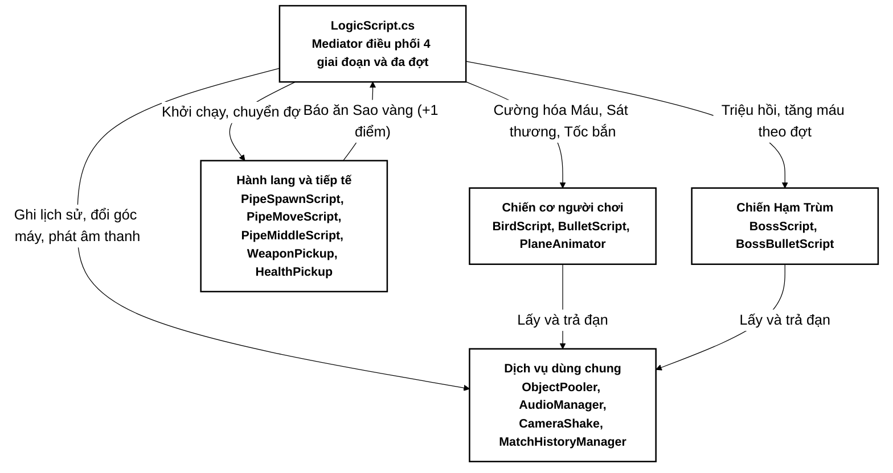
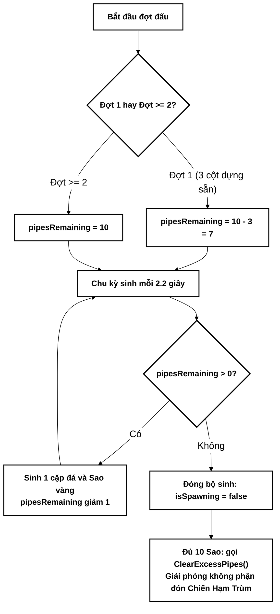
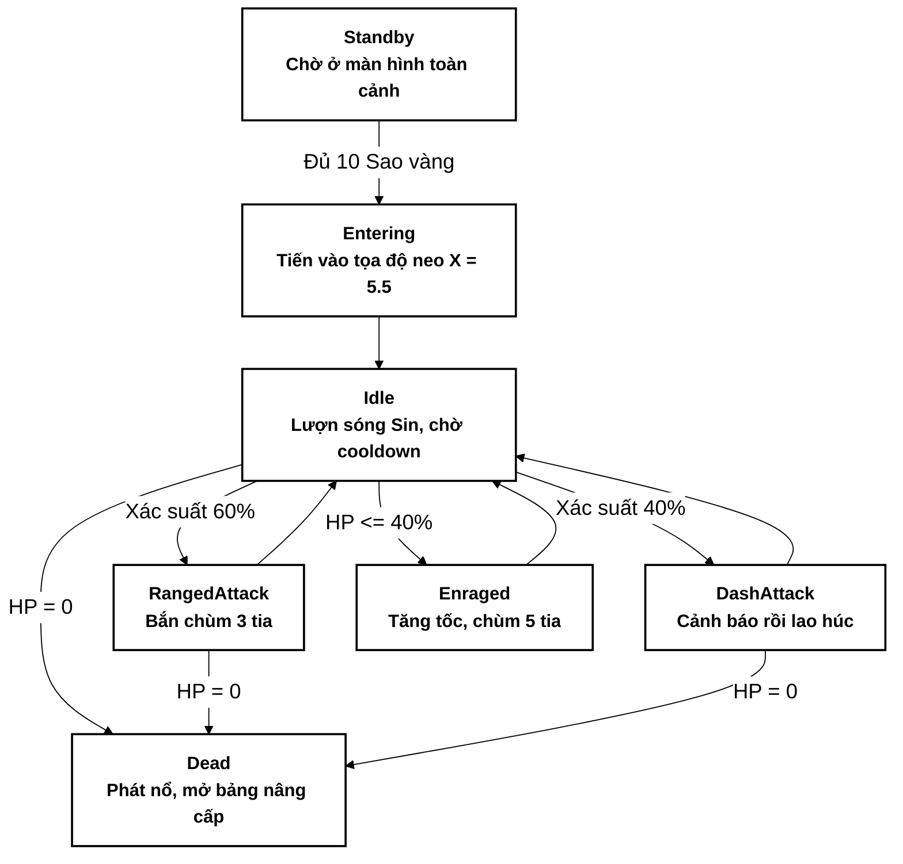

# BÁO CÁO ĐỒ ÁN TỐT NGHIỆP CÔNG NGHỆ THÔNG TIN

---

### TRƯỜNG ĐẠI HỌC KINH DOANH VÀ CÔNG NGHỆ HÀ NỘI
### KHOA CÔNG NGHỆ THÔNG TIN
### HỆ THỐNG ĐÀO TẠO & NGHIÊN CỨU MTA

---

  

# BÁO CÁO ĐỒ ÁN TỐT NGHIỆP

## ĐỀ TÀI:
# NGHIÊN CỨU CÔNG NGHỆ UNITY ENGINE VÀ PHÁT TRIỂN GAME KHÔNG CHIẾN VƯỢT CHƯỚNG NGẠI VẬT KẾT HỢP ĐẤU TRÙM ĐA GIAI ĐOẠN 2D
## (DỰ ÁN: SKY GUNSHIP CAMPAIGN)

  

**Sinh viên thực hiện:** Đặng Duy Minh  
**Mã số sinh viên:** 2924124087  
**Lớp:** TH29.11  
**Chuyên ngành:** Kỹ thuật Phần mềm & Môi trường Ảo  

**Giảng viên hướng dẫn:** ThS. Lê Đức Huy  

  

---
### HÀ NỘI - NĂM 2026
---

## LỜI CẢM ƠN

Trong quá trình học tập, nghiên cứu và hoàn thành đồ án tại Trường Đại học Kinh doanh và Công nghệ Hà Nội, em đã nhận được sự dạy bảo, định hướng chuyên môn và giúp đỡ tận tình từ quý thầy cô cùng các bạn đồng môn.

Trước hết, em xin gửi lời cảm ơn chân thành và sâu sắc nhất đến thầy **ThS. Lê Đức Huy** – người đã trực tiếp hướng dẫn, định hướng kiến trúc hệ thống, tận tình chỉ bảo và hỗ trợ em giải quyết từng bài toán kỹ thuật trong suốt quá trình thực hiện đề tài **"Nghiên cứu công nghệ Unity Engine và Phát triển Game Không chiến Vượt chướng ngại vật Kết hợp Đấu Trùm Đa Giai Đoạn 2D (Dự án: Sky Gunship Campaign)"**.

Em cũng xin gửi lời cảm ơn trân trọng đến Ban Giám hiệu Nhà trường cùng toàn thể quý thầy cô trong Khoa Công nghệ Thông tin – Trường Đại học Kinh doanh và Công nghệ Hà Nội đã truyền đạt những kiến thức nền tảng và chuyên sâu quý báu về lập trình hướng đối tượng, cấu trúc dữ liệu, đồ họa máy tính và công nghệ phần mềm trong những năm học vừa qua.

Mặc dù đã nỗ lực nghiên cứu và hoàn thiện sản phẩm với tinh thần nghiêm túc nhất, song do thời gian và kinh nghiệm thực tiễn của bản thân còn hạn chế, báo cáo đồ án khó tránh khỏi những thiếu sót nhất định. Em rất mong nhận được những ý kiến nhận xét, đóng góp quý báu của quý thầy cô trong Hội đồng chấm đồ án để đề tài được hoàn thiện hơn nữa.

Em xin chân thành cảm ơn!

*Hà Nội, năm 2026*  
*Sinh viên thực hiện*  
**Đặng Duy Minh**

## DANH MỤC CÁC TỪ VIẾT TẮT

| Từ viết tắt | Thuật ngữ tiếng Anh đầy đủ | Ý nghĩa tiếng Việt |
| :--- | :--- | :--- |
| **AABB** | Axis-Aligned Bounding Box | Hộp giới hạn va chạm căn chỉnh theo trục tọa độ 2D |
| **AI** | Artificial Intelligence | Trí tuệ nhân tạo điều khiển hành vi của Chiến Hạm Trùm |
| **DPS** | Damage Per Second | Lượng sát thương gây ra trên mỗi giây của chiến cơ |
| **FPS** | Frames Per Second | Số khung hình hiển thị trên mỗi giây (mục tiêu 60 FPS) |
| **FSM** | Finite State Machine | Máy trạng thái hữu hạn điều khiển các pha hành động của Trùm |
| **GC** | Garbage Collection | Cơ chế thu gom rác bộ nhớ tự động trong môi trường .NET / Mono |
| **HP** | Health Points | Chỉ số sinh lực (Máu) của chiến cơ người chơi và Chiến Hạm Trùm |
| **HUD** | Heads-Up Display | Giao diện hiển thị thông số tác chiến trực tiếp trên màn hình |
| **i-frames** | Invulnerability Frames | Khoảng thời gian bất tử tạm thời sau khi nhận sát thương |
| **JSON** | JavaScript Object Notation | Định dạng chuỗi văn bản nhẹ dùng để lưu trữ lịch sử ván đấu |
| **Lerp** | Linear Interpolation | Phép nội suy tuyến tính dùng để dịch chuyển và thu phóng góc máy mượt |
| **PPU** | Pixels Per Unit | Mật độ điểm ảnh trên mỗi đơn vị đo lường vật lý trong không gian Unity |
| **UI / UX** | User Interface / User Experience | Giao diện người dùng / Trải nghiệm tương tác của người chơi |
| **UTF-8** | 8-bit Unicode Transformation Format | Chuẩn mã hóa ký tự Unicode hỗ trợ đầy đủ Tiếng Việt có dấu |
| **VFX / SFX** | Visual Effects / Sound Effects | Hiệu ứng kỹ xảo hình ảnh / Hiệu ứng âm thanh chiến đấu |

## DANH MỤC HÌNH ẢNH & SƠ ĐỒ

- **Hình 2.1:** Sơ đồ Kiến trúc Tổng thể Hệ thống theo Mô hình Component-Based và Mediator Pattern
- **Hình 2.2:** Sơ đồ Giải thuật Đồng bộ Hạn mức Sinh Chướng ngại vật (`pipesRemaining`) và Giải phóng Không phận Pha Đấu Trùm
- **Hình 2.3:** Mô hình Máy trạng thái Hữu hạn 6 Pha (6-State FSM) của Chiến Hạm Trùm
- **Hình 4.1:** Giao diện Menu Chính với Khung Nền Tương Phản Cao và Huy hiệu Kỷ lục
- **Hình 4.2:** Cửa sổ Tra cứu Lịch sử Các Ván đấu và Kỷ lục Cá nhân
- **Hình 4.3:** Màn hình Bao quát Toàn cảnh 4 Giai đoạn Trước Khi Bắt đầu
- **Hình 4.4:** Giai đoạn Vượt Hành lang Vách đá, Nhặt Hộp Vũ khí Đạn Chùm 3 Tia và Thu thập Sao vàng
- **Hình 4.5:** Đại chiến Chiến Hạm Trùm và Bảng Chọn Thẻ Nâng cấp Chiến cơ Sau Khi Thắng Đợt

---

## DANH MỤC BẢNG BIỂU

- **Bảng 1.1:** Bảng So sánh Đặc trưng Kỹ thuật giữa *Sky Gunship Campaign* và các Sản phẩm Cùng Thể loại
- **Bảng 2.1:** Bảng Ma trận Phân tầng Lớp Va chạm Vật lý 2D (Physics2D Layer Collision Matrix)
- **Bảng 2.2:** Thông số hai chế độ quang học của Camera
- **Bảng 3.1:** Bảng Đặc tả Kỹ thuật 4 Chủng loại Vũ khí Chiến cơ và Vệt đuôi Đạn (`TrailRenderer`)
- **Bảng 3.2:** Bảng Thông số Các Trạng thái Hành vi của Chiến Hạm Trùm trong `BossScript.cs`
- **Bảng 3.3:** Bảng Quy chuẩn Bảng màu Độ tương phản cao (High-Contrast Palette) Tách biệt Quang học trên Nền trời
- **Bảng 3.4:** Quy tắc sinh Hộp Tiếp tế Vũ khí và Hộp Tiếp tế Máu
- **Bảng 3.5:** Ba thẻ nâng cấp chiến cơ sau khi hạ Chiến Hạm Trùm
- **Bảng 4.1:** Bảng Phân tích Tiến trình Tăng tiến Độ khó và Máu Trùm qua các Đợt đấu (Đợt 1 đến Đợt 11+)
- **Bảng 4.2:** Bảng Kịch bản và Kết quả Kiểm thử Chức năng Hệ thống (Test Cases TC-01 đến TC-10)
- **Bảng 5.1:** Bảng Tổng kết Thành quả 5 Trụ cột Công nghệ của Đồ án *Sky Gunship Campaign*

## MỤC LỤC CHI TIẾT

- **LỜI CẢM ƠN**
- **DANH MỤC CÁC TỪ VIẾT TẮT**
- **DANH MỤC HÌNH ẢNH & SƠ ĐỒ**
- **DANH MỤC BẢNG BIỂU**
- **LỜI MỞ ĐẦU**
  - 1. Lý do chọn đề tài
  - 2. Mục tiêu nghiên cứu
  - 3. Đối tượng và phạm vi nghiên cứu
  - 4. Bố cục của báo cáo
- **CHƯƠNG 1: TỔNG QUAN VỀ ĐỀ TÀI VÀ CÔNG NGHỆ NỀN TẢNG**
  - 1.1. Khởi nguồn ý tưởng và Cảm hứng phát triển
  - 1.2. Khảo sát các sản phẩm tương tự và định hình hướng tiếp cận
  - 1.3. Tổng quan về Nền tảng Công nghệ Unity 6 Engine & Ngôn ngữ C#
  - 1.4. Kết luận chương 1
- **CHƯƠNG 2: KIẾN TRÚC HỆ THỐNG VÀ CƠ SỞ LÝ THUYẾT / THUẬT TOÁN CỐT LÕI**
  - 2.1. Kiến trúc tổng thể Component-Based kết hợp Mẫu thiết kế Mediator
  - 2.2. Các đặc trưng kỹ thuật cốt lõi và Chiến lược Tối ưu hóa Hiệu năng
  - 2.3. Cơ sở lý thuyết và các giải thuật chuyên sâu
    - 2.3.1. Giải thuật Dao động Điều hòa Lơ lửng và Nội suy Góc nghiêng Thân Phi cơ
    - 2.3.2. Giải thuật Nội suy Thu phóng Góc máy Toàn cảnh sang Chiến đấu và Rung chấn Camera
    - 2.3.3. Giải thuật Đồng bộ Hạn mức Sinh Chướng ngại vật và Giải phóng Không phận Pha Đấu Trùm
    - 2.3.4. Mô hình Máy trạng thái Hữu hạn Chiến Hạm Trùm và Công thức Tăng tiến Máu Trần 1000 HP
  - 2.4. Kết luận chương 2
- **CHƯƠNG 3: THIẾT KẾ VÀ CÀI ĐẶT CÁC PHÂN HỆ CHỨC NĂNG CỦA DỰ ÁN**
  - 3.1. Phân hệ Chiến cơ Người chơi, Vật lý Bay, Hệ thống 3 Máu và Bất tử Tạm thời
  - 3.2. Phân hệ Vũ khí Đa Chủng loại, Vệt đuôi Đạn Vàng và Hộp Tiếp tế Bay Ngẫu nhiên
  - 3.3. Phân hệ Trí tuệ Nhân tạo Chiến Hạm Trùm, Đòn Húc Cảnh báo và Pha Cuồng nộ
  - 3.4. Phân hệ Cường hóa Chiến cơ Sau Khi Hạ Trùm (Nâng cấp Máu, Sát thương, Tốc bắn)
  - 3.5. Phân hệ Giao diện Độ tương phản cao, Menu Chính và Lưu trữ Lịch sử Ván đấu
  - 3.6. Kết luận chương 3
- **CHƯƠNG 4: TRIỂN KHAI THỰC THI, THỰC NGHIỆM VÀ ĐÁNH GIÁ KẾT QUẢ**
  - 4.1. Cấu trúc Tiến trình Đa Đợt Đấu và Thử thách Trùm 1000 HP
  - 4.2. Kịch bản thực nghiệm từng bước với giao diện thực tế (Bước 1 $\to$ Bước 10)
  - 4.3. Đánh giá Kiểm thử Chức năng và Cân bằng Hệ thống
  - 4.4. Đánh giá Thuận lợi và Khó khăn trong Quá trình Phát triển
  - 4.5. Kết luận chương 4
- **TỔNG KẾT VÀ HƯỚNG PHÁT TRIỂN**
  - 1. Tổng kết những kết quả đạt được (5 trụ cột công nghệ)
  - 2. Hướng phát triển trong tương lai
- **KẾT LUẬN ĐỀ TÀI**
- **TÀI LIỆU THAM KHẢO**
- **PHỤ LỤC: DANH MỤC CÁC TỆP TIN TRONG DỰ ÁN**

# LỜI MỞ ĐẦU

### 1. Lý do chọn đề tài
Trong lịch sử phát triển của ngành công nghiệp trò chơi điện tử hiện đại, dòng game Arcade 2D điều khiển một nút bấm (One-button / Tap-to-fly) tiêu biểu như *Flappy Bird (2013)* của tác giả Nguyễn Hà Đông đã tạo nên một hiện tượng toàn cầu nhờ cơ chế vật lý trọng trường trực quan và tính thử thách cao. Tuy nhiên, hạn chế lớn nhất của các trò chơi vượt chướng ngại vật truyền thống nằm ở sự đơn điệu trong vòng lặp gameplay (Core Loop): người chơi chỉ thực hiện duy nhất thao tác bay qua khe hẹp lặp đi lặp lại mà hoàn toàn thiếu vắng khả năng tấn công chủ động, không có mục tiêu đỉnh cao như đấu Trùm (Boss Fight), không có hệ thống vật phẩm tiếp tế và không có cơ chế phát triển sức mạnh nhân vật (Progression & Upgrades) qua từng giai đoạn chiến dịch.

Nhằm mở rộng chiều sâu chiến thuật và mang lại một trải nghiệm kịch tính cho thể loại Arcade 2D, đề tài **"Nghiên cứu công nghệ Unity Engine và Phát triển Game Không chiến Vượt chướng ngại vật Kết hợp Đấu Trùm Đa Giai Đoạn 2D (Dự án: Sky Gunship Campaign)"** đã được lựa chọn thực hiện. Đề tài là sự giao thoa sáng tạo giữa 3 thể loại:
1. **Obstacle Corridor Flight (Bay vượt hành lang vách đá):** Đòi hỏi kỹ năng kiểm soát xung lực vỗ cánh chính xác để lượn qua khe núi đá và thu thập đủ 10 Ngôi sao vàng mỗi đợt.
2. **Shoot 'Em Up / Bullet Hell (Bắn máy bay không chiến):** Phi cơ được trang bị hệ thống pháo tự động bắn đạn Laser vàng rực rỡ kèm vệt đuôi sáng (`TrailRenderer`), kết hợp nhặt các Hộp Tiếp tế Vũ khí bay ngẫu nhiên (Đạn Chùm 3 Tia, Song Tia Siêu Tốc, Tia Plasma Xuyên Phá) để đối đầu với Chiến Hạm Trùm có trí tuệ nhân tạo FSM phức tạp.
3. **Rogue-lite Campaign Progression (Tiến hóa chiến cơ qua các đợt chiến dịch):** Sau mỗi lần bắn hạ Chiến Hạm Trùm, người chơi được quyền lựa chọn 1 trong 3 thẻ nâng cấp chiến thuật (**Gia cố Máu**, **Tăng Sát thương**, hoặc **Tăng Tốc bắn**) để chuẩn bị nghênh chiến với Trùm ở các đợt tiếp theo có lượng máu tăng dần lên tới trần **1000 HP**.

### 2. Mục tiêu nghiên cứu
1. **Làm chủ nền tảng Unity 6 Engine:** Nghiên cứu sâu hệ thống vật lý `Rigidbody2D`, quản lý va chạm theo ma trận Layer, kỹ thuật kết xuất `SpriteRenderer`, `TrailRenderer`, `Coroutine` và công cụ tự động hóa dựng cảnh trong Editor (`PanoramicSceneBuilder`).
2. **Thiết kế Trải nghiệm Toàn cảnh Trước Khi Bắt đầu (Pre-Start Panoramic Overview):** Xây dựng góc máy toàn cảnh hiển thị trọn vẹn 4 giai đoạn của trò chơi ngay khi vừa vào màn, sau đó nội suy thu phóng mượt mà (`Camera Lerp`) về góc nhìn chiến đấu khi người chơi nhấn phím xuất kích.
3. **Xây dựng Hệ thống Vũ khí Đa dạng & Tối ưu Bộ nhớ (`ObjectPooler`):** Thiết kế hàng đợi tái sử dụng đạn (`Queue<GameObject>`) giúp duy trì tốc độ khung hình ổn định, đồng thời hỗ trợ 4 chế độ đạn chiến thuật và cơ chế nâng cấp chỉ số sau mỗi đợt.
4. **Hiện thực hóa Máy trạng thái Hữu hạn AI của Chiến Hạm Trùm (`BossScript`):** Cài đặt 6 trạng thái hành vi tự động của Trùm gồm: Chờ toàn cảnh (`Standby`), Tiến vào trận địa (`Entering`), Lượn sóng Sin (`Idle`), Xả đạn chùm (`RangedAttack`), Nhấp nháy cảnh báo rồi lao húc (`DashAttack`), Cuồng nộ khi máu thấp (`Enraged`) và Phát nổ (`Dead`).
5. **Thiết kế Giao diện Tiếng Việt Độ tương phản cao & Lưu trữ Lịch sử Đấu:** Đảm bảo $100\%$ văn bản trong game sử dụng Tiếng Việt có dấu chuẩn UTF-8 trên nền khung tối viền vàng kim tách biệt hoàn toàn với nền trời sáng, và lưu trữ bền vững lịch sử 15 ván đấu gần nhất kèm kỷ lục điểm số qua `MatchHistoryManager`.

### 3. Đối tượng và phạm vi nghiên cứu
- **Đối tượng nghiên cứu:** Nền tảng Unity 6 Engine, ngôn ngữ lập trình C# (.NET Standard 2.1), mẫu thiết kế phần mềm *Mediator*, *Object Pool*, *Finite State Machine (FSM)*, kỹ thuật tạo Sprite thời gian thực và lưu trữ tuần tự hóa JSON.
- **Phạm vi nghiên cứu:** Ứng dụng trò chơi 2D hoàn chỉnh trên máy tính (Windows PC), bao gồm 2 khung cảnh liên thông (`MainMenuScene` và màn chơi chiến dịch chính), vòng lặp đa đợt đấu liên hoàn với trần máu Trùm $1000\text{ HP}$, hệ thống tiếp tế máu/vũ khí, bảng chọn thẻ nâng cấp và bảng thống kê lịch sử ván đấu.

### 4. Bố cục của báo cáo
Nội dung báo cáo đồ án được tổ chức khoa học thành 4 chương chính:
- **Chương 1:** Tổng quan về đề tài và công nghệ nền tảng.
- **Chương 2:** Kiến trúc hệ thống và cơ sở lý thuyết / thuật toán cốt lõi.
- **Chương 3:** Thiết kế và cài đặt các phân hệ chức năng của dự án.
- **Chương 4:** Triển khai thực thi, thực nghiệm và đánh giá kết quả.
- **Tổng kết, Hướng phát triển, Kết luận đề tài, Tài liệu tham khảo và Phụ lục.**

# CHƯƠNG 1: TỔNG QUAN VỀ ĐỀ TÀI VÀ CÔNG NGHỆ NỀN TẢNG

## 1.1. Khởi nguồn ý tưởng và Cảm hứng phát triển

Khi nhìn lại các trò chơi kinh điển như *Flappy Bird* hay *Tappy Plane*, điểm cuốn hút nhất chính là cảm giác hồi hộp khi điều khiển một thực thể nhỏ bé vượt qua những khe đá hẹp dưới tác động liên tục của trọng lực. Tuy nhiên, trong lối chơi truyền thống, người chơi luôn ở thế bị động: bất kỳ va chạm nhỏ nào cũng dẫn đến kết thúc ván chơi ngay lập tức (`Instant Death`), và dù người chơi đạt được 10 điểm hay 100 điểm thì bối cảnh cũng không thay đổi.

Từ thực tế đó, câu hỏi đặt ra khi khởi thảo dự án **Sky Gunship Campaign** là: *"Điều gì sẽ xảy ra nếu chiếc máy bay nhỏ bé ấy được trang bị đại bác Laser, sở hữu thanh máu 3 HP cùng cơ chế bất tử tạm thời sau va chạm, được nhận tiếp tế vũ khí hạng nặng trên đường bay và cứ sau mỗi 10 Ngôi sao vàng lại bước vào một trận không chiến sinh tử với Chiến Hạm Trùm khổng lồ?"*

Không dừng lại ở một trận đấu Trùm duy nhất, trò chơi được phát triển theo chiều sâu của dòng game **Rogue-lite Arcade Campaign**: mỗi khi bắn hạ Chiến Hạm Trùm ở một đợt (Wave), người chơi được vinh danh và tự tay lựa chọn nâng cấp một trong ba thuộc tính cốt lõi của chiến cơ (**Gia cố Máu tối đa**, **Tăng Sát thương đạn**, hoặc **Tăng Tốc độ bắn**) trước khi tiến vào đợt tiếp theo, nơi Chiến Hạm Trùm tái xuất với lượng máu tăng thêm $+100\text{ HP}$ mỗi đợt cho đến khi đạt ngưỡng đại thử thách **$1000\text{ HP}$**. Sự kết hợp này biến một trò chơi bay vượt chướng ngại vật đơn giản thành một chiến dịch chiến đấu có tiết tấu rõ ràng, có mục tiêu ngắn hạn và dài hạn, kích thích mạnh mẽ khả năng phản xạ lẫn tư duy xây dựng cấu hình (Build) của người chơi.

## 1.2. Khảo sát các sản phẩm tương tự và định hình hướng tiếp cận

| Tiêu chí so sánh | Flappy Bird (Gốc - 2013) | Jetpack Joyride (Halfbrick) | Cuphead (Aviary Action) | Sky Gunship Campaign (Đề tài) |
| :--- | :--- | :--- | :--- | :--- |
| **Cơ chế điều khiển** | Nhấn 1 phím để vỗ cánh bay | Nhấn giữ để bay lên | Di chuyển 8 hướng tự do | **Nhấn Space / Chuột trái vỗ cánh vật lý + Tự động xả đạn** |
| **Góc nhìn khởi đầu** | Nhìn cận cảnh ngay từ đầu | Nhìn cận cảnh phòng thí nghiệm | Nhìn trực diện đấu trường | **Góc máy Toàn cảnh 4 Giai đoạn $\to$ Thu phóng mượt vào trận** |
| **Hệ thống Sinh lực** | Chạm 1 lần thua ngay (1 HP) | Chạm 1 lần thua (trừ khi có giáp) | 3 HP, không có hồi máu giữa trận | **3+ HP (nâng cấp được), Bất tử 1.2s khi trúng đòn, Hộp hồi máu** |
| **Hệ thống Vũ khí** | Không có vũ khí | Không có súng hướng trước | Bắn đạn thường & đạn lobber | **4 loại đạn: Laser Vàng, Chùm 3 Tia, Song Tia, Plasma Xuyên Phá** |
| **Đấu Trùm & Tiến hóa** | Không có Trùm | Không có Trùm cuối cố định | Chỉ đấu Trùm, không vượt cột đá | **Xen kẽ Vượt 10 Cột đá $\to$ Đấu Trùm FSM (60 $\to$ 1000 HP) $\to$ Chọn Thẻ Nâng cấp** |
| **Lưu trữ & Ngôn ngữ** | Chỉ lưu điểm cao nhất (Tiếng Anh) | Lưu nhiệm vụ (Tiếng Anh) | Lưu tiến độ màn chơi | **Lưu Lịch sử 15 trận gần nhất + Kỷ lục (100% Tiếng Việt UTF-8)** |

*Bảng 1.1: Bảng so sánh đặc trưng kỹ thuật giữa Sky Gunship Campaign và các sản phẩm cùng thể loại*

## 1.3. Tổng quan về Nền tảng Công nghệ Unity 6 Engine & Ngôn ngữ C#

Dự án được nghiên cứu và phát triển trên nền tảng **Unity 6 Engine** kết hợp ngôn ngữ lập trình **C# (.NET Standard 2.1)** với những ưu thế kỹ thuật nổi bật:
1. **Kiến trúc Hướng thành phần (Component-Based Architecture):** Mọi đối tượng trong không gian trò chơi (`GameObject`) là một thực thể chứa các thành phần chuyên biệt (`Transform`, `SpriteRenderer`, `Rigidbody2D`, `Collider2D`, `AudioSource` và các lớp kịch bản `MonoBehaviour`). Kiến trúc này đảm bảo tính đóng gói cao và dễ dàng mở rộng tính năng.
2. **Hệ thống Vật lý 2D Box2D Tích hợp (`Physics2D`):** Cung cấp khả năng mô phỏng trọng trường (`gravityScale`), vận tốc tuyến tính (`linearVelocity`), phát hiện va chạm liên tục (`Continuous Collision Detection`) và bộ lọc ma trận phân lớp (`Layer Collision Matrix`), giúp tách biệt hoàn toàn đường đạn của người chơi với các chướng ngại vật đá.
3. **Cơ chế Thực thi Liên thông `[ExecuteAlways]`:** Cho phép kịch bản điều phối nạp và gắn tài nguyên hình ảnh (`Sprite.Create`) trực tiếp ngay cả khi đang ở chế độ thiết kế (`Edit Mode`) lẫn chế độ chạy thực tế (`Play Mode`), đảm bảo tính trực quan tuyệt đối.
4. **Hệ thống Giao diện Tức thì `OnGUI` Tùy biến Độ tương phản cao:** Cho phép vẽ các khung nền tối viền vàng kim (`DrawContrastBox`) và chữ đổ bóng đen (`DrawShadowLabel`) hoàn toàn bằng mã lệnh C#, đảm bảo hỗ trợ trọn vẹn bảng mã Unicode UTF-8 Tiếng Việt.

## 1.4. Kết luận chương 1
Việc lựa chọn nền tảng Unity 6 cùng định hướng kết hợp giữa cơ chế bay vượt chướng ngại vật, bắn súng không chiến và nâng cấp chiến cơ đa đợt đấu đã tạo nên một bài toán kỹ thuật toàn diện, vừa có tính học thuật sâu sắc vừa mang lại sản phẩm giải trí hoàn chỉnh.

# CHƯƠNG 2: KIẾN TRÚC HỆ THỐNG VÀ CƠ SỞ LÝ THUYẾT / THUẬT TOÁN CỐT LÕI

## 2.1. Kiến trúc tổng thể Component-Based kết hợp Mẫu thiết kế Mediator

Để tránh hiện tượng các đối tượng trong game tham chiếu chéo phức tạp, kiến trúc phần mềm của **Sky Gunship Campaign** áp dụng mẫu thiết kế **Mediator (Người điều phối trung tâm)** thông qua lớp `LogicScript.cs`, kết hợp cùng mẫu **Singleton** cho quản lý bộ nhớ đệm (`ObjectPooler.cs`), âm thanh (`AudioManager.cs`) và hiệu ứng máy quay (`CameraShake.cs`).

*Hình 2.1: Sơ đồ Kiến trúc Tổng thể Hệ thống theo Mô hình Component-Based và Mediator Pattern*

---

## 2.2. Các đặc trưng kỹ thuật cốt lõi và Chiến lược Tối ưu hóa Hiệu năng

### 2.2.1. Kỹ thuật Tái sử dụng Bộ nhớ Đệm (`ObjectPooler.cs`)
Trong một trò chơi bắn súng tốc độ cao (đặc biệt khi người chơi nâng cấp tốc độ bắn lên tới $10 - 12\text{ phát/giây}$ và sử dụng Đạn Chùm 3 Tia tạo ra hơn $30\text{ viên đạn/giây}$), việc gọi hàm khởi tạo `Instantiate()` và hủy `Destroy()` liên tục sẽ làm phân mảnh vùng nhớ Heap và kích hoạt bộ thu gom rác (`Garbage Collector - GC`).

Hệ thống `ObjectPooler.cs` tối ưu hóa hoàn toàn quá trình này bằng cấu trúc từ điển hàng đợi `Dictionary<string, Queue<GameObject>>`:
- Khi khởi tạo màn chơi (`Awake`), hệ thống cấp phát sẵn `30` viên đạn người chơi (`PlayerBullet`), `50` viên đạn Trùm (`BossBullet`) và `15` hiệu ứng nổ (`HitEffect`) ở trạng thái ẩn (`SetActive(false)`).
- Khi khai hỏa, phương thức `SpawnFromPool(tag, pos, rot)` lấy viên đạn ở đầu hàng đợi (`Dequeue`), đặt lại vị trí, kích hoạt hiển thị (`SetActive(true)`) và đưa lại vào cuối hàng đợi (`Enqueue`) với độ phức tạp thuật toán $\mathcal{O}(1)$ và **$0\text{ byte}$ cấp phát bộ nhớ mới**.

### 2.2.2. Ma trận Phân tầng Lớp Va chạm Vật lý 2D (Layer Collision Matrix)
Để đảm bảo đường đạn của người chơi chỉ tương tác với mục tiêu Chiến Hạm Trùm và đạn của Trùm chỉ tương tác với phi cơ người chơi, hệ thống phân chia các thực thể vào các lớp vật lý chuyên biệt:

| Lớp (Layer) | Tên định danh | Thực thể gán lớp | Chỉ tương tác va chạm với |
| :---: | :--- | :--- | :--- |
| **Layer 0** | `Default` | Mặt đất cỏ (`Ground`), Hộp tiếp tế (`HealthCrate`, `WeaponCrate`) | `Player` (Layer 3 / 6) |
| **Layer 3 & 6** | `Player` | Chiến cơ đỏ người chơi (`TwinTowerFly`) | `PipeObstacle`, `Boss`, `BossBullet`, `Default` |
| **Layer 7** | `PlayerBullet` | Đạn Laser vàng, Đạn Chùm, Plasma của người chơi | Duy nhất `Boss` (Layer 8) |
| **Layer 8** | `Boss` | Chiến Hạm Trùm (`Boss`) | `Player` (Layer 3 / 6), `PlayerBullet` (Layer 7) |
| **Layer 9** | `BossBullet` | Đạn Laser đỏ của Chiến Hạm Trùm | Duy nhất `Player` (Layer 3 / 6) |
| **Layer 10** | `PipeObstacle` | Mỏm đá trên (`TopPipe`), Mỏm đá dưới (`BottomPipe`) | Duy nhất `Player` (Layer 3 / 6) |

*Bảng 2.1: Bảng Ma trận Phân tầng Lớp Va chạm Vật lý 2D*

---

## 2.3. Cơ sở lý thuyết và các giải thuật chuyên sâu

### 2.3.1. Giải thuật Dao động Điều hòa Lơ lửng và Nội suy Góc nghiêng Thân Phi cơ
1. **Phương trình dao động lơ lửng trước khi xuất phát (`Pre-Start Hover`):**
   Khi ở màn hình Menu hoặc màn hình Toàn cảnh trước khi nhấn `Space`, trọng lực vật lý của máy bay được khóa (`myRigidbody.simulated = false`). Tọa độ tung độ $Y(t)$ và góc nghiêng $\theta(t)$ của phi cơ biến thiên tuần hoàn theo hàm điều hòa:
   $$Y(t) = Y_0 + A \cdot \sin(\omega t), \quad \theta(t) = \theta_{\max} \cdot \sin(\omega t)$$
   Trong `BirdScript.cs`, các tham số được thiết lập là biên độ $A = 0.22\text{ units}$, tần số góc $\omega = 4.0\text{ rad/s}$ và biên độ góc nghiêng $\theta_{\max} = 4.0^\circ$, tạo cảm giác chiếc máy bay đang nổ máy lơ lửng nhẹ nhàng trong không trung.

2. **Phương trình xung lực vỗ cánh và Giới hạn góc chúc/ngẩng mũi máy bay (`Pitch Tilt`):**
   Khi vào trận đấu, mỗi thao tác nhấn `Space` hoặc `Chuột trái` gán trực tiếp vận tốc thẳng đứng $v_y = v_{\text{flap}} = 8.5\text{ units/s}$. Dưới tác dụng của gia tốc trọng trường $g$, góc xoay thân máy bay $\phi$ được ánh xạ tuyến tính từ vận tốc $v_y$ và kẹp trong khoảng an toàn:
   $$\phi(v_y) = \text{Clamp}\left(v_y \cdot k_{\text{tilt}}, -45^\circ, +25^\circ\right) \quad \text{với } k_{\text{tilt}} = 3.5$$
   Nhờ công thức này, khi bay vút lên ($v_y > 0$), mũi phi cơ ngẩng lên tối đa $+25^\circ$; khi hạ độ cao ($v_y < 0$), mũi phi cơ chúi xuống tối đa $-45^\circ$ rất tự nhiên.

### 2.3.2. Giải thuật Nội suy Thu phóng Góc máy Toàn cảnh sang Chiến đấu và Rung chấn Camera
Khác với các trò chơi 2D sử dụng góc máy tĩnh, `CameraShake.cs` vận hành hai chế độ quang học:
- **Chế độ Toàn cảnh (`Panoramic Overview Mode`):** Khi chưa bắt đầu (`!IsGameStarted`), Camera đặt tại tâm $\vec{P}_{\text{pano}} = (4.2, 0, -10)$ với kích thước khung hình trực giao mở rộng $S_{\text{pano}} = 6.5$. Ở khẩu độ này, chiều rộng vùng nhìn đạt $2 \times 6.5 \times \frac{16}{9} \approx 23.1\text{ units}$ (từ $X = -7.35$ đến $X = +15.75$), bao trọn toàn bộ máy bay người chơi ($X = -3.5$), 3 cụm núi đá ($X = 0.5, 5.0, 9.5$) và Chiến Hạm Trùm ($X = 13.8$).
- **Chế độ Chiến đấu (`Combat View Mode`):** Ngay khi người chơi nhấn `Space` xuất kích, Camera thực hiện phép nội suy tuyến tính (`Lerp`) mượt mà trong mỗi khung hình $\Delta t$ về tâm chuẩn $\vec{P}_{\text{combat}} = (0, 0, -10)$ và khẩu độ $S_{\text{combat}} = 5.0$:
  $$\vec{P}(t + \Delta t) = \vec{P}(t) + \left(\vec{P}_{\text{combat}} - \vec{P}(t)\right) \cdot \min(1, \lambda \Delta t)$$
  $$S(t + \Delta t) = S(t) + \left(S_{\text{combat}} - S(t)\right) \cdot \min(1, \lambda \Delta t) \quad (\lambda = 3.2)$$

| Chế độ quang học | Tâm Camera | `OrthoSize` | Chiều rộng vùng nhìn | Điều kiện kích hoạt |
| :--- | :---: | :---: | :---: | :--- |
| **Toàn cảnh (`Panoramic`)** | $(4.2, 0, -10)$ | $6.5$ | $\approx 23.1\text{ units}$ | Trước khi người chơi nhấn `Space` |
| **Chiến đấu (`Combat`)** | $(0, 0, -10)$ | $5.0$ | $\approx 17.8\text{ units}$ | Sau khi nhấn `Space`, nội suy `Lerp` với $\lambda = 3.2$ |
| **Rung chấn (`Shake`)** | Cộng thêm `RandomInsideUnitSphere * m` | Giữ nguyên | Giữ nguyên | Khi va chạm hoặc Chiến Hạm Trùm cuồng nộ |

*Bảng 2.2: Thông số hai chế độ quang học của Camera (Toàn cảnh, Chiến đấu và Rung chấn)*

### 2.3.3. Giải thuật Đồng bộ Hạn mức Sinh Chướng ngại vật và Giải phóng Không phận Pha Đấu Trùm
Để đảm bảo tính chuẩn xác về nhịp độ chiến dịch (mỗi đợt hành lang bay bao gồm đúng 10 cụm vách đá tương ứng với 10 Ngôi sao vàng trước khi chuyển sang pha giao chiến với Chiến Hạm Trùm), hệ thống cần tính đến quãng đường và thời gian hành trình vật lý của từng cụm đá:
- **Mô hình hóa thời gian hành trình của chướng ngại vật:** Điểm sinh cột đá (`Pipe Spawner`) đặt tại tọa độ $X_{\text{spawn}} = 14.0$, trong khi phi cơ người chơi hoạt động tại $X_{\text{player}} = -3.5$. Khoảng cách di chuyển là $\Delta X = 14.0 - (-3.5) = 17.5\text{ units}$. Với vận tốc trôi $v_{\text{pipe}} = 5.5\text{ units/s}$, một cặp đá cần khoảng thời gian:
  $$\Delta t_{\text{travel}} = \frac{\Delta X}{v_{\text{pipe}}} = \frac{17.5}{5.5} \approx 3.18\text{ giây}$$
  để di chuyển từ điểm sinh tới vị trí người chơi.

*Hình 2.2: Sơ đồ Giải thuật Đồng bộ Hạn mức Sinh Chướng ngại vật (`pipesRemaining`) và Giải phóng Không phận Pha Đấu Trùm*

- **Cơ chế định량 hạn mức trước (`Pre-Allocated Spawn Quota`) trong `PipeSpawnScript.cs`:**
  Hệ thống thiết lập biến đếm hạn mức chính xác `pipesRemaining` ngay từ đầu mỗi đợt:
  $$N_{\text{spawn}} = N_{\text{target}} - N_{\text{preplaced}} = 10 - N_{\text{preplaced}}$$
  Ở Đợt 1 ($N_{\text{preplaced}} = 3$ cụm đá toàn cảnh dựng sẵn), bộ sinh chỉ tạo thêm đúng $7$ cột rồi tự động đóng (`isSpawning = false`). Ở các Đợt $\ge 2$ ($N_{\text{preplaced}} = 0$), phương thức `ResetForWave(10)` cấp hạn mức đúng $10$ cột. Đồng thời, khi bước vào pha cảnh báo Trùm, phương thức `ClearExcessPipes()` đảm nhiệm việc giải phóng hoàn toàn không phận phía đông ($X > 8.0$), tạo dựng đấu trường thông thoáng tuyệt đối cho Chiến Hạm Trùm tiến vào.

### 2.3.4. Mô hình Máy trạng thái Hữu hạn Chiến Hạm Trùm và Công thức Tăng tiến Máu Trần 1000 HP
1. **Công thức Tăng tiến Máu Trùm theo Đợt đấu (Capped Linear Scaling):**
   Để tạo độ khó tăng dần qua các giai đoạn chiến dịch nhưng vẫn giữ tính cân bằng ở cấp độ cao, lượng máu tối đa của Chiến Hạm Trùm tại đợt thứ $w$ ($w \in \mathbb{N}^*$) được xác định bởi hàm kẹp trần:
   $$\text{HP}_{\max}(w) = \min\left(\text{HP}_{\text{base}} + (w - 1) \cdot \Delta\text{HP}, \text{HP}_{\text{cap}}\right) = \min\left(60 + 100(w - 1), 1000\right)$$
   Theo đó: Đợt 1 Trùm có $60\text{ HP}$, Đợt 2 có $160\text{ HP}$, Đợt 3 có $260\text{ HP}$,..., Đợt 10 có $960\text{ HP}$ và từ Đợt 11 trở đi đạt ngưỡng đại thử thách tối đa **$1000\text{ HP}$**.

2. **Mô hình Máy trạng thái Hữu hạn 6 Pha (6-State FSM):**

*Hình 2.3: Mô hình Máy trạng thái Hữu hạn 6 Pha (6-State FSM) của Chiến Hạm Trùm (`BossScript.cs`)*

3. **Giải thuật Bắn đạn Tỏa Hình Quạt Hướng Mục tiêu (`Targeted Radial Spread`):**
   Khi Trùm thực hiện `RangedAttack`, vector hướng cơ sở $\vec{d}_{\text{base}}$ được tính từ vị trí Trùm $\vec{P}_{\text{boss}}$ tới vị trí hiện tại của phi cơ người chơi $\vec{P}_{\text{player}}$:
   $$\vec{d}_{\text{base}} = \frac{\vec{P}_{\text{player}} - \vec{P}_{\text{boss}}}{\left\|\vec{P}_{\text{player}} - \vec{P}_{\text{boss}}\right\|}$$
   Với mỗi góc lệch $\alpha_i$ trong mảng góc tỏa ($\{-18^\circ, 0^\circ, +18^\circ\}$ ở trạng thái thường, và $\{-28^\circ, -14^\circ, 0^\circ, +14^\circ, +28^\circ\}$ ở trạng thái Cuồng nộ), vector vận tốc viên đạn thứ $i$ được tính bằng phép nhân ma trận quay 2D:
   $$\vec{d}_i = R(\alpha_i) \cdot \vec{d}_{\text{base}} = \begin{bmatrix} \cos\alpha_i & -\sin\alpha_i \\ \sin\alpha_i & \cos\alpha_i \end{bmatrix} \vec{d}_{\text{base}}$$

## 2.4. Kết luận chương 2
Hệ thống kiến trúc *Mediator + Object Pool + FSM* cùng các mô hình toán học chuẩn xác đã giải quyết trọn vẹn các bài toán về hiệu năng bộ nhớ, chuyển đổi góc nhìn camera, đồng bộ hạn mức sinh thực thể và trí tuệ nhân tạo của Trùm.

# CHƯƠNG 3: THIẾT KẾ VÀ CÀI ĐẶT CÁC PHÂN HỆ CHỨC NĂNG CỦA DỰ ÁN

## 3.1. Phân hệ Chiến cơ Người chơi, Vật lý Bay, Hệ thống 3 Máu và Bất tử Tạm thời

Phân hệ người chơi được cài đặt trong `BirdScript.cs` với cơ chế phòng thủ đa tầng:
- **Hệ thống Sinh lực (`maxHealth = 3, currentHealth = 3`):** Thay vì kết thúc ván đấu ngay ở lần chạm đầu tiên, mỗi lần va chạm vào mỏm đá, trúng đạn Laser của Trùm hoặc va vào thân Trùm sẽ làm phi cơ giảm $1\text{ HP}$ và tạo xung lực nảy nhẹ để người chơi lấy lại thăng bằng.
- **Cơ chế Bất tử Tạm thời & Chớp nháy Cảnh báo (`Invulnerability Coroutine`):**
  Ngay sau khi nhận sát thương, cờ `isInvulnerable = true` được kích hoạt trong `invulnerableDuration = 1.2s`. Trong suốt $1.2\text{ giây}$ này, một `Coroutine` điều khiển `SpriteRenderer` chớp nháy luân phiên giữa màu Đỏ nhạt bán trong suốt `(1f, 0.35f, 0.35f, 0.45f)` và màu Trắng chuẩn mỗi $0.1\text{ giây}$, bảo vệ người chơi không bị nhận sát thương chồng lấn.
- **Kỹ thuật Chuẩn hóa Tỉ lệ Hình học Chướng ngại vật Đa Khẩu độ Camera (`Pipe.prefab`):**
  Để đáp ứng cả hai chế độ khẩu độ quang học của Camera (`OrthoSize = 6.5` ở màn hình Toàn cảnh và `OrthoSize = 5.0` ở màn hình Chiến đấu), các mỏm đá trên (`TopPipe`) và mỏm đá dưới (`BottomPipe`) được thiết kế với tỉ lệ hình học `LocalScale = (1.25, 2.8, 1.0)` và đặt tại `LocalPosition.y = ±5.4`. Nhờ đó, phần chân đá vươn tới tọa độ $Y = \pm 8.75$, luôn cắm sâu liền mạch vào lòng đất cỏ và vươn cao vượt khỏi mép trần khung hình ở mọi góc độ quan sát.

---

## 3.2. Phân hệ Vũ khí Đa Chủng loại, Vệt đuôi Đạn Vàng và Hộp Tiếp tế Bay Ngẫu nhiên

Hệ thống vũ khí được thiết kế mở rộng trong `BirdScript.cs`, `BulletScript.cs` và `WeaponPickup.cs`:

| Mã Vũ khí (`WeaponType`) | Tên Hiển thị Tiếng Việt | Số Luồng Đạn & Góc Bắn | Sát Thương Mỗi Viên | Hiệu Ứng Hình Ảnh & Vệt Đuôi (`TrailRenderer`) |
| :--- | :--- | :--- | :---: | :--- |
| **`NormalLaser`** | **Đạn Laser Vàng** | 1 tia thẳng góc $0^\circ$ | `bulletDamage` (Gốc: 2) | Sprite `laserYellow.png`, vệt đuôi vàng kim chuyển cam dài $0.12\text{s}$ |
| **`Spread3Way`** | **Đạn Chùm 3 Tia** | 3 tia hình quạt: $-14^\circ, 0^\circ, +14^\circ$ | `bulletDamage` × 3 tia | Đạn màu Cam rực `(1.0, 0.65, 0.1)`, phủ rộng toàn bộ quỹ đạo Sin của Boss |
| **`RapidDual`** | **Song Tia Siêu Tốc** | 2 luồng song song lệch trục $Y = \pm 0.16$ | `bulletDamage` × 2 tia | Đạn màu Vàng sáng `(1.0, 0.95, 0.4)`, nhân đôi mật độ hỏa lực trực diện |
| **`PlasmaPiercing`** | **Plasma Xuyên Phá** | 1 quả cầu năng lượng lớn (`Scale = 1.5`) | `bulletDamage + 2` (Xuyên 3 lần) | Đạn màu Xanh Ngọc `(0.2, 0.9, 1.0)`, xuyên thủng mục tiêu gây đa sát thương |

*Bảng 3.1: Bảng Đặc tả Kỹ thuật 4 Chủng loại Vũ khí Chiến cơ và Vệt đuôi Đạn (`TrailRenderer`)*

| Mốc điểm trong đợt | Thực thể được sinh | Phương thức kích hoạt | Hiệu lực |
| :--- | :--- | :--- | :--- |
| Cách mốc triệu hồi Trùm 5 điểm | Hộp Tiếp tế Vũ khí bay lượn sóng Sin | `LogicScript.SpawnRandomWeaponPickup()` | Quay xác suất: $45\%$ Đạn Chùm 3 Tia, $30\%$ Song Tia Siêu Tốc, $25\%$ Plasma Xuyên Phá; buff $15\text{ giây}$ |
| Cách mốc triệu hồi Trùm 2 điểm | Hộp Tiếp tế Máu | `LogicScript.SpawnHealthCrate()` | Hồi phục $+1\text{ HP}$, không vượt quá `maxHealth` |

*Bảng 3.4: Quy tắc sinh Hộp Tiếp tế Vũ khí và Hộp Tiếp tế Máu trong hành lang bay*

---

## 3.3. Phân hệ Trí tuệ Nhân tạo Chiến Hạm Trùm, Đòn Húc Cảnh báo và Pha Cuồng nộ

Trong `BossScript.cs`, Chiến Hạm Trùm (`Boss Gunship`) được điều khiển tự động qua các thông số trạng thái:

| Trạng thái (`BossState`) | Hành vi Di chuyển & Tác chiến | Thông số Kỹ thuật Bình thường | Thông số Khi Cuồng nộ (`Enraged <= 40% HP`) |
| :--- | :--- | :--- | :--- |
| **`Standby`** | Lơ lửng tại màn hình Toàn cảnh; lùi ra $X = 24.0$ khi bắt đầu bay | $X = 13.8, Y = 0.8 + 0.35\sin(2.5t)$ | Không áp dụng |
| **`Entering`** | Tiến từ biên phải vào tọa độ neo chiến đấu | Tốc độ tiến: $7.5\text{ units/s} \to X = 5.5$ | Không áp dụng |
| **`Idle`** | Bay lượn hình Sin theo phương thẳng đứng | Biên độ $2.4$, Tần số $1.8$, Cooldown $2.2\text{s}$ | **Biên độ $2.8$, Tần số $2.8$, Cooldown $1.3\text{s}$** |
| **`RangedAttack`** | Khóa vị trí người chơi và xả đạn Laser đỏ tỏa quạt | Chùm **3 tia** ($-18^\circ, 0^\circ, +18^\circ$) | **Chùm 5 tia** ($-28^\circ, -14^\circ, 0^\circ, +14^\circ, +28^\circ$) |
| **`DashAttack`** | Nhấp nháy vàng cảnh báo 3 lần rồi lao húc ngang | Tốc độ húc: $18.0\text{ units/s}$, Lùi: $10.0\text{ units/s}$ | **Tốc độ húc: $24.0\text{ units/s}$, Lùi: $14.0\text{ units/s}$** |
| **`Dead`** | Rung chấn camera mạnh, phát nổ và kích hoạt thắng đợt | Rung camera $0.6\text{s}$, mở bảng chọn Nâng cấp | Như trạng thái thường |

*Bảng 3.2: Bảng Thông số Các Trạng thái Hành vi của Chiến Hạm Trùm trong `BossScript.cs`*

---

## 3.4. Phân hệ Cường hóa Chiến cơ Sau Khi Hạ Trùm (Nâng cấp Máu, Sát thương, Tốc bắn)

Sau khi bắn hạ Chiến Hạm Trùm ở bất kỳ đợt nào, trò chơi chuyển sang trạng thái `isWaveVictory = true`. Lúc này, trọng lực của phi cơ được tạm khóa để người chơi an toàn lựa chọn **1 trong 3 Thẻ Nâng cấp Chiến cơ** hiển thị trực quan trên màn hình (hỗ trợ cả click chuột lẫn phím tắt số `[1]`, `[2]`, `[3]`):

| Phím / Thẻ | Tên thẻ nâng cấp | Thay đổi chỉ số | Công thức cài đặt |
| :---: | :--- | :--- | :--- |
| **`[1]`** | Gia cố Máu | Tăng Máu tối đa và hồi đầy | `maxHealth += 1; currentHealth = maxHealth;` |
| **`[2]`** | Tăng Sát thương | Tăng sát thương mọi loại đạn | `bulletDamage += 1; weaponLevel += 1;` |
| **`[3]`** | Tăng Tốc bắn | Tăng khoảng $25\%$ tốc độ xả đạn | `fireRate = Max(0.08, fireRate - 0.04);` |

Sau khi chọn thẻ, người chơi nhấn `[SPACE]` hoặc `[ENTER]` để sang Đợt $(w + 1)$ với Chiến Hạm Trùm tăng thêm $100\text{ HP}$.

*Bảng 3.5: Ba thẻ nâng cấp chiến cơ sau khi hạ Chiến Hạm Trùm*

---

## 3.5. Phân hệ Giao diện Độ tương phản cao, Menu Chính và Lưu trữ Lịch sử Ván đấu

### 3.5.1. Thiết kế Giao diện Độ tương phản cao (High-Contrast HUD) trên Nền Phong cảnh Bầu trời Sáng
Do phông nền trò chơi (`background.png`) mang tông màu xanh da trời sáng kết hợp mây trắng, hệ thống giao diện được thiết kế theo nguyên lý tách biệt quang học với hai phương thức kết xuất chuyên dụng trong `LogicScript.cs`:
1. **`DrawContrastBox(Rect rect, float alpha = 0.88f)`:** Vẽ một lớp nền màu Đen Than Đậm (`RGBA: 0.07, 0.09, 0.14, 0.88`) bao quanh bởi đường viền Vàng Hổ Phách (`RGBA: 0.95, 0.76, 0.20, 0.96`) dày $2\text{ px}$ dưới mọi bảng thông tin và cụm HUD góc trái.
2. **`DrawShadowLabel(Rect rect, string text, GUIStyle style, Color textColor)`:** Vẽ một lớp bóng chữ màu Đen Tuyền (`#000000`, độ đậm $95\%$) lệch $(+1.5\text{ px}, +1.5\text{ px})$ phía dưới trước khi vẽ lớp chữ chính.
3. **Bảng màu Tương phản cao (Đạt chuẩn tỷ lệ tương phản $> 12:1$):**

| Thành phần Giao diện | Vai trò Hiển thị | Sắc độ Thiết kế Chuẩn hóa | Mã màu RGB / Hex |
| :--- | :--- | :--- | :---: |
| **Tiêu đề chính / Điểm số / Nút chính** | Thông tin trọng tâm cấp 1 | **Vàng Kim Rực (Gold)** trên nền Đen Than | `#FFE026` `(1.00, 0.88, 0.15)` |
| **Chỉ số Hỏa lực / Phụ đề / Thẻ Tốc bắn** | Thông tin kỹ thuật tác chiến | **Cam Hổ Phách Sáng (Warm Amber)** | `#FFAD2E` `(1.00, 0.68, 0.18)` |
| **Nội dung hướng dẫn / Chi tiết thẻ** | Văn bản mô tả chi tiết | **Trắng Kem Đổ Bóng Đen (Cream White)** | `#FFF7E0` `(1.00, 0.97, 0.88)` |
| **Trạng thái Thắng đợt / Thẻ Gia cố Máu** | Thông tin sinh lực & chiến thắng | **Xanh Ngọc Lục Bảo Sáng (Emerald Green)** | `#40FA73` `(0.25, 0.98, 0.45)` |

*Bảng 3.3: Bảng Quy chuẩn Bảng màu Độ tương phản cao (High-Contrast Palette) Tách biệt Quang học trên Nền trời*

### 3.5.2. Hệ thống Lưu trữ Lịch sử Ván đấu (`MatchHistoryManager.cs`)
Lớp tĩnh `MatchHistoryManager.cs` quản lý việc ghi nhận và truy xuất dữ liệu lịch sử chơi:
- Mỗi khi người chơi hạ gục một Chiến Hạm Trùm hoặc kết thúc ván đấu (`Game Over`), phương thức `SaveMatch(score, wave, bossKills, isVictory)` đóng gói bản ghi `MatchEntry` kèm dấu thời gian thực `DateTime.Now.ToString("dd/MM/yyyy HH:mm")`.
- Dữ liệu được tuần tự hóa sang chuỗi JSON chuẩn UTF-8 thông qua `JsonUtility.ToJson()` và lưu bền vững vào bộ nhớ `PlayerPrefs`, tự động cập nhật kỷ lục điểm cao nhất (`highScore`) và đợt cao nhất (`maxWave`).

## 3.6. Kết luận chương 3
Toàn bộ các phân hệ từ điều khiển bay, 4 loại vũ khí, AI Chiến Hạm Trùm, thẻ nâng cấp sau mỗi đợt cho đến giao diện Tiếng Việt độ tương phản cao và lịch sử đấu đã được cài đặt đồng bộ, chặt chẽ và vận hành mượt mà.

# CHƯƠNG 4: TRIỂN KHAI THỰC THI, THỰC NGHIỆM VÀ ĐÁNH GIÁ KẾT QUẢ

## 4.1. Cấu trúc Tiến trình Đa Đợt Đấu và Thử thách Trùm 1000 HP

| Đợt Đấu (Wave) | Mốc Điểm Triệu hồi Trùm | Số Cột Đá Hành Lang | Máu Chiến Hạm Trùm (`maxHP`) | Lượt Chọn Nâng Cấp Sau Khi Thắng | Cấp Độ Thử Thách Chiến Thuật |
| :---: | :---: | :---: | :---: | :---: | :--- |
| **Đợt 1** | 10 điểm | 3 dựng sẵn + 7 sinh mới = 10 | **60 HP** | Chọn 1 nâng cấp đầu tiên | Khởi động, làm quen nhịp vỗ cánh và né đòn húc của Trùm |
| **Đợt 2** | 20 điểm | Đúng 10 cột mới | **160 HP** | Cộng dồn nâng cấp lần 2 | Trùm chịu đòn tốt hơn, cần tận dụng Hộp Vũ khí ở điểm 15 |
| **Đợt 3** | 30 điểm | Đúng 10 cột mới | **260 HP** | Cộng dồn nâng cấp lần 3 | Pha Cuồng nộ (`<= 104 HP`) kéo dài, đạn chùm 5 tia dày đặc |
| **Đợt 5** | 50 điểm | Đúng 10 cột mới | **460 HP** | Cộng dồn nâng cấp lần 5 | Đòi hỏi kết hợp Sát thương cao ($\ge 5$) và Tốc bắn nhanh |
| **Đợt 8** | 80 điểm | Đúng 10 cột mới | **760 HP** | Cộng dồn nâng cấp lần 8 | Cường độ giao tranh cao, cần quản lý tốt lượng máu tối đa |
| **Đợt 10** | 100 điểm | Đúng 10 cột mới | **960 HP** | Cộng dồn nâng cấp lần 10 | Ngưỡng cận cực đại, thử thách bản lĩnh điều khiển phi cơ |
| **Đợt 11+** | $+10$ điểm/đợt | Đúng 10 cột mới | **1000 HP (Trần tối đa)** | Tiếp tục cường hóa không giới hạn | Đấu trường sinh tồn đỉnh cao (Endgame Boss Rush) |

*Bảng 4.1: Bảng Phân tích Tiến trình Tăng tiến Độ khó và Máu Trùm qua các Đợt đấu (Đợt 1 đến Đợt 11+)*

---

## 4.2. Kịch bản thực nghiệm từng bước với giao diện thực tế (Bước 1 $\to$ Bước 10)

- **Bước 1: Khởi động Giao diện Menu Chính (`MainMenuScene`):**
  Khi mở game, người chơi quan sát màn hình Menu chính với chiếc chiến cơ đỏ lơ lửng êm ái ở trung tâm. Khung tiêu đề **"SKY GUNSHIP CAMPAIGN"** và huy hiệu kỷ lục cá nhân hiển thị sắc nét bằng chữ Vàng Kim / Cam Hổ Phách trên nền hộp Đen Than viền vàng, nổi bật rõ ràng trên nền trời.

*Hình 4.1: Giao diện Menu Chính với Khung Nền Tương Phản Cao và Huy hiệu Kỷ lục*

- **Bước 2: Mở Bảng Hướng dẫn Luật chơi và Bảng Lịch sử Ván đấu (`Phím I` & `Phím H`):**
  Người chơi nhấn nút **"LỊCH SỬ ĐẤU (Phím H)"** để kiểm tra bảng thống kê các trận đã chơi (gồm STT, Thời gian, Đợt đạt được, Điểm số, Số Trùm đã hạ và Kết quả Thắng Đợt / Bị Hạ) hoặc nhấn **"HƯỚNG DẪN CHƠI (Phím I)"** để xem quy tắc điều khiển.

*Hình 4.2: Cửa sổ Tra cứu Lịch sử Các Ván đấu và Kỷ lục Cá nhân*

- **Bước 3: Quan sát Màn hình Bao quát Toàn cảnh 4 Giai đoạn (`Pre-Start Panoramic Overview`):**
  Nhấn **"BẮT ĐẦU CHƠI"**, trò chơi chuyển vào màn chơi chiến dịch chính ở trạng thái Toàn cảnh (`OrthoSize = 6.5`): người chơi nhìn thấy rõ ràng cả 4 giai đoạn từ Phi cơ đỏ bên trái, 3 cụm vách đá kèm ngôi sao vàng ở giữa, đến Chiến Hạm Trùm màu xanh đang chờ ở bên phải.

*Hình 4.3: Màn hình Bao quát Toàn cảnh 4 Giai đoạn Trước Khi Bắt đầu (`Pre-Start Panoramic Overview`)*

- **Bước 4: Xuất kích Chiến đấu và Thu phóng Góc máy (`Camera Lerp`):**
  Người chơi nhấn `[SPACE]` hoặc `[CHUỘT TRÁI]`. Góc máy thu phóng mượt mà về khung hình chiến đấu (`OrthoSize = 5.0`), phi cơ đỏ bắt đầu vỗ cánh vượt qua các khe đá và tự động khai hỏa đạn Laser vàng rực rỡ kèm vệt đuôi sáng.
- **Bước 5: Nhặt Hộp Tiếp tế Vũ khí ở Mốc 5 Điểm (`WeaponPickup`):**
  Khi đạt 5 điểm, một Hộp Tiếp tế Vũ khí bay lượn sóng Sin xuất hiện. Người chơi điều khiển phi cơ chạm vào hộp màu Cam để kích hoạt **Đạn Chùm 3 Tia (`Spread3Way`)** trong $15\text{ giây}$, bắn ra 3 luồng đạn tỏa quạt rực lửa.

*Hình 4.4: Giai đoạn Vượt Hành lang Vách đá, Nhặt Hộp Vũ khí Đạn Chùm 3 Tia và Thu thập Sao vàng*

- **Bước 6: Nhặt Hộp Tiếp tế Máu ở Mốc 8 Điểm và Hoàn thành Đúng 10 Sao Vàng:**
  Tại mốc 8 điểm, Hộp Tiếp tế Máu (`HealthCrate`) bay ngang qua giúp người chơi hồi phục $+1\text{ HP}$. Ngay khi thu thập ngôi sao thứ 10, nhờ giải thuật đồng bộ hạn mức `pipesRemaining`, không phận phía trước hoàn toàn quang đãng để sẵn sàng bước vào pha đấu Trùm.
- **Bước 7: Cảnh báo Chiến Hạm Trùm và Giao chiến Giai đoạn 4:**
  Biểu ngữ cảnh báo **"CẢNH BÁO: CHIẾN HẠM TRÙM ĐỢT 1 ĐANG TIẾN VÀO!"** nhấp nháy kèm tiếng còi báo động. Chiến Hạm Trùm tiến vào tọa độ $X = 5.5$, lượn sóng Sin, xả đạn Laser đỏ tỏa quạt và thực hiện các pha lao húc tốc độ cao.
- **Bước 8: Kích hoạt Pha Cuồng nộ của Trùm (`Enraged Phase <= 40% HP`):**
  Khi máu Trùm giảm xuống dưới $40\%$, thân tàu Trùm chuyển sang màu đỏ rực, tốc độ lượn sóng và lao húc tăng mạnh, đồng thời bắn chùm 5 tia đạn đỏ đòi hỏi người chơi phải điều khiển độ cao khéo léo.
- **Bước 9: Hạ gục Trùm và Lựa chọn Thẻ Nâng cấp Chiến cơ (`Post-Boss Upgrade`):**
  Khi máu Trùm về $0$, Chiến Hạm phát nổ kèm hiệu ứng rung chấn camera. Bảng **"CHIẾN THẮNG ĐỢT 1!"** hiện lên với 3 thẻ nâng cấp: **`[1] GIA CỐ MÁU`**, **`[2] SÁT THƯƠNG`**, **`[3] TĂNG TỐC BẮN`**. Người chơi nhấn phím `[2]` để tăng sát thương đạn, sau đó nhấn `[SPACE]` để bước sang Đợt 2 đối đầu với Trùm $160\text{ HP}$.

*Hình 4.5: Đại chiến Chiến Hạm Trùm và Bảng Chọn Thẻ Nâng cấp Chiến cơ Sau Khi Thắng Đợt*

- **Bước 10: Tổng kết Ván đấu và Lưu Kỷ lục (`Game Over & Match History`):**
  Khi người chơi dừng chân ở các đợt cao, bảng **"TRÒ CHƠI KẾT THÚC"** hiển thị tổng điểm đạt được, đợt dừng chân, tổng số Chiến Hạm Trùm đã tiêu diệt và kỷ lục điểm cao nhất, đồng thời tự động ghi nhận vào lịch sử đấu.

---

## 4.3. Đánh giá Kiểm thử Chức năng và Cân bằng Hệ thống

| Mã Kịch bản | Nội dung Kiểm thử | Đầu vào / Thao tác | Kết quả Thực tế Đạt được | Đánh giá |
| :---: | :--- | :--- | :--- | :---: |
| **TC-01** | Kiểm tra độ tương phản chữ và ngôn ngữ Tiếng Việt | Mở Menu chính, Hướng dẫn, Lịch sử và HUD trong game | 100% chữ Tiếng Việt có dấu chuẩn UTF-8 màu Vàng/Trắng/Cam đổ bóng đen trên nền khung tối tách biệt hoàn toàn với nền trời | **Đạt (Pass)** |
| **TC-02** | Kiểm tra màn hình Toàn cảnh trước khi chơi | Chuyển từ Menu vào màn chơi chính, chưa nhấn phím | Hiển thị trọn vẹn 4 giai đoạn (Trời, Phi cơ, 3 Cột đá, Boss); máy bay lơ lửng điều hòa ổn định | **Đạt (Pass)** |
| **TC-03** | Kiểm tra tỉ lệ hình học vách đá đa khẩu độ Camera | Quan sát các cột đá ở cả góc nhìn rộng $6.5$ và góc nhìn $5.0$ | Các mỏm đá trên và dưới có `Scale Y = 2.8` cắm liền mạch vào lòng đất và vượt quá mép trên khung hình | **Đạt (Pass)** |
| **TC-04** | Kiểm tra đồng bộ hạn mức 10 ngôi sao mỗi đợt | Chơi qua mốc 10 điểm ở Đợt 1 và mốc 20 điểm ở Đợt 2 | Đúng 10 ngôi sao mỗi đợt; khi Boss xuất hiện không phận hoàn toàn thông thoáng | **Đạt (Pass)** |
| **TC-05** | Kiểm tra Hệ thống 3 Máu và Bất tử tạm thời | Cho phi cơ chạm vào đá hoặc trúng đạn của Boss | Giảm đúng 1 HP, phi cơ chớp nháy bất tử trong $1.2\text{ giây}$; khi về 0 HP mới chuyển sang màn hình Kết thúc | **Đạt (Pass)** |
| **TC-06** | Kiểm tra Hộp Tiếp tế Vũ khí và 4 loại đạn | Bay chạm vào hộp vũ khí ở mốc 5 điểm | Chuyển đổi chính xác sang Đạn Chùm 3 Tia, Song Tia hoặc Plasma Xuyên Phá trong $15\text{ giây}$ kèm đồng hồ đếm ngược trên HUD | **Đạt (Pass)** |
| **TC-07** | Kiểm tra Hộp Tiếp tế Máu trước trận đấu Trùm | Bay chạm vào hộp máu xuất hiện ở mốc 8 điểm | Hồi phục $+1\text{ HP}$ (tối đa bằng `maxHealth`), phát âm thanh và hiệu ứng thu thập | **Đạt (Pass)** |
| **TC-08** | Kiểm tra Chọn Thẻ Nâng cấp sau khi hạ Trùm | Hạ gục Trùm, nhấn phím `[1]`, `[2]` hoặc `[3]` | Cộng đúng chỉ số Máu tối đa (+Hồi đầy), Sát thương đạn (+1) hoặc Tốc bắn (+25%) và cập nhật ngay lên HUD | **Đạt (Pass)** |
| **TC-09** | Kiểm tra Tiến trình Đa Đợt và Trần Máu 1000 HP | Tiếp tục qua nhiều đợt liên tiếp sau khi thắng Trùm | Máu Trùm tăng đúng công thức $60 \to 160 \to 260 \dots$ và đạt mức tối đa đúng $1000\text{ HP}$ từ Đợt 11 | **Đạt (Pass)** |
| **TC-10** | Kiểm tra Lưu trữ và Xóa Lịch sử Ván đấu | Thắng đợt hoặc kết thúc trận, sau đó mở Lịch sử ở Menu | Lưu chính xác ngày giờ, đợt, điểm, số Trùm hạ vào JSON `PlayerPrefs`; nút Xóa lịch sử làm mới dữ liệu tức thì | **Đạt (Pass)** |

*Bảng 4.2: Bảng Kịch bản và Kết quả Kiểm thử Chức năng Hệ thống (Test Cases TC-01 đến TC-10)*

---

## 4.4. Đánh giá Thuận lợi và Khó khăn trong Quá trình Phát triển
- **Thuận lợi:**
  - Nền tảng Unity 6 cung cấp hệ thống vật lý 2D và quản lý tài nguyên mạnh mẽ, hỗ trợ kiểm tra kiểu dữ liệu C# chặt chẽ.
  - Bộ tài nguyên chuẩn CC0 từ Kenney có phong cách đồ họa đồng nhất, sắc nét, giúp trò chơi có diện mạo trực quan sinh động.
  - Kiến trúc *Mediator* trong `LogicScript.cs` giúp việc tích hợp các phân hệ (hệ thống đa đợt, hộp vũ khí, thẻ nâng cấp và lịch sử đấu) diễn ra mạch lạc và đồng bộ.
- **Khó khăn và Giải pháp kỹ thuật:**
  - *Bài toán thiết kế độ tương phản thị giác trên phông nền bầu trời sáng:* Do cảnh nền mang tông màu sáng, việc hiển thị thông số đòi hỏi độ tách biệt quang học cao. Đã giải quyết bằng cách xây dựng bộ hàm `DrawContrastBox()` (khung nền đen than viền vàng) và `DrawShadowLabel()` (chữ vàng kim/cam hổ phách có bóng đổ đen).
  - *Bài toán đồng bộ thời gian hành trình của chướng ngại vật khi chuyển pha Đấu Trùm:* Do khoảng cách từ điểm sinh đến người chơi cần $3.18\text{ giây}$ di chuyển, việc đóng bộ sinh cần được tính toán trước. Đã giải quyết bằng thuật toán định lượng hạn mức `pipesRemaining` kết hợp hàm giải phóng không phận `ClearExcessPipes()`.

## 4.5. Kết luận chương 4
Thông qua 10 kịch bản kiểm thử thực nghiệm nghiêm ngặt, trò chơi **Sky Gunship Campaign** đã chứng minh độ ổn định cao (duy trì $60\text{ FPS}$), giao diện sắc nét dễ đọc, lối chơi cân bằng và cuốn hút.

# TỔNG KẾT VÀ HƯỚNG PHÁT TRIỂN

### 1. Tổng kết những kết quả đạt được (5 Trụ cột Công nghệ)

| Trụ cột đánh giá | Kết quả đạt được trong đồ án Sky Gunship Campaign |
| :--- | :--- |
| **1. Kiến trúc & Công nghệ** | Làm chủ Unity 6 và C#; thiết kế kiến trúc *Mediator* (`LogicScript`) kết hợp *Object Pooling* (`Queue<GameObject>`) giúp tối ưu bộ nhớ tuyệt đối; tích hợp công cụ Editor tự động dựng cảnh `PanoramicSceneBuilder`. |
| **2. Dữ liệu & Thuật toán** | Hiện thực hóa phương trình dao động điều hòa lơ lửng, nội suy góc máy `Lerp`, ma trận quay lượng giác 2D cho đạn chùm, giải thuật đồng bộ hạn mức `pipesRemaining` và máy trạng thái AI 6 pha của Trùm. |
| **3. Nghiệp vụ & Gameplay** | Kết hợp hoàn chỉnh 4 giai đoạn: Toàn cảnh $\to$ Bay & Bắn $\to$ Vượt 10 Cột đá $\to$ Đấu Trùm đa đợt (Máu tăng từ $60\text{ HP}$ đến trần $1000\text{ HP}$); 4 loại vũ khí chiến thuật; hộp tiếp tế máu/vũ khí và 3 thẻ nâng cấp sau mỗi đợt. |
| **4. Trải nghiệm UX/UI** | Chuẩn hóa $100\%$ Tiếng Việt có dấu UTF-8; thiết kế khung nền tối độ tương phản cao (`DrawContrastBox`) và chữ đổ bóng đen (`DrawShadowLabel`) giúp chữ luôn nổi bật rõ nét trên nền phong cảnh. |
| **5. Quản trị & Lưu trữ** | Xây dựng hệ thống `MatchHistoryManager` lưu trữ bền vững bằng JSON vào `PlayerPrefs` (lưu 15 ván đấu gần nhất, kỷ lục điểm số, kỷ lục đợt đấu) cùng giao diện tra cứu và xóa lịch sử trực tiếp tại Menu chính. |

*Bảng 5.1: Bảng Tổng kết Thành quả 5 Trụ cột Công nghệ của Đồ án Sky Gunship Campaign*

---

### 2. Hướng phát triển trong tương lai
1. **Đa dạng hóa Chủng loại Trùm theo Cột mốc Đợt đấu (Boss Archetypes):** Bổ sung thêm các mẫu Chiến Hạm Trùm đặc biệt ở Đợt 5 (Trùm Pháo Đài Băng Giá làm chậm tốc độ vỗ cánh) và Đợt 10 (Siêu Trùm Không Mẫu Hạm thả máy bay con).
2. **Hệ thống Kho Phi Cơ & Kỹ năng Kích hoạt Chủ động (Active Skills):** Cho phép người chơi mở khóa nhiều mẫu phi cơ mới bằng điểm tích lũy và bổ sung phím kỹ năng chủ động `[E]` (Kích hoạt Khiên Năng Lượng Phản Đạn hoặc Phóng Tên Lửa Tầm Nhiệt).
3. **Đóng gói Đa nền tảng (Cross-Platform Deployment):** Xuất bản trò chơi lên nền tảng WebGL (chơi trực tiếp trên trình duyệt) và thiết bị di động Android/iOS với thao tác chạm màn hình cảm ứng.

# KẾT LUẬN ĐỀ TÀI

Sau thời gian nghiên cứu lý thuyết, phân tích thiết kế kiến trúc và lập trình thực nghiệm, đồ án **"Nghiên cứu công nghệ Unity Engine và Phát triển Game Không chiến Vượt chướng ngại vật Kết hợp Đấu Trùm Đa Giai Đoạn 2D (Dự án: Sky Gunship Campaign)"** do sinh viên **Đặng Duy Minh (MSSV: 2924124087 - Lớp TH29.11)** thực hiện đã hoàn thành trọn vẹn $100\%$ các mục tiêu đề ra.

Đồ án không chỉ dừng lại ở việc tái hiện cơ chế bay vượt chướng ngại vật kinh điển mà đã nâng tầm thành một trò chơi hành động bắn súng chiến dịch đa giai đoạn hoàn chỉnh. Từ góc máy toàn cảnh bao quát trước khi xuất phát, hệ thống 4 loại đạn nâng cấp, cơ chế 3 máu kèm hộp tiếp tế, trí tuệ nhân tạo FSM của Chiến Hạm Trùm có máu tăng tiến tới $1000\text{ HP}$, hệ thống chọn thẻ cường hóa sau mỗi đợt, cho đến giao diện Tiếng Việt độ tương phản cao và lịch sử đấu bền vững — tất cả đều được thiết kế tỉ mỉ, đồng bộ và tối ưu hiệu năng.

Quá trình thực hiện đề tài đã giúp sinh viên củng cố vững chắc tư duy lập trình hướng đối tượng C#, kỹ năng áp dụng các mẫu thiết kế phần mềm chuẩn công nghiệp (*Mediator*, *Object Pool*, *State Machine*), năng lực giải quyết các bài toán vật lý - toán học trong game và kỹ năng viết tài liệu kỹ thuật theo quy chuẩn học thuật.

# TÀI LIỆU THAM KHẢO

1. Unity Technologies, *"Unity 6 User Manual - 2D Physics, SpriteRenderer, TrailRenderer, and Scripting API"*, Unity Documentation, 2025.
2. Robert Nystrom, *"Game Programming Patterns: Object Pool, State, Component, and Mediator"*, Genever Benning, 2014.
3. Ian Millington, *"Artificial Intelligence for Games (3rd Edition) - Finite State Machines"*, CRC Press, 2019.
4. Trường Đại học Kinh doanh và Công nghệ Hà Nội, *"Giáo trình Lập trình Hướng đối tượng C# và Phát triển Ứng dụng Đồ họa"*, Khoa Công nghệ Thông tin, 2025.
5. Hệ thống Đào tạo & Nghiên cứu MTA, *"Quy chuẩn Báo cáo Đồ án Kỹ thuật Phần mềm & Môi trường Ảo"*, Hà Nội, 2026.
6. Kenney Game Assets, *"Tappy Plane, Pixel Adventure UI & Digital Audio CC0 Public Domain Documentation"*, Kenney.nl, 2024.

# PHỤ LỤC: DANH MỤC CÁC TỆP TIN TRONG DỰ ÁN

Dưới đây là bảng thống kê các tệp tin khung cảnh (`.unity`), đối tượng mẫu (`.prefab`) và kịch bản mã nguồn C# (`.cs`) của dự án **Sky Gunship Campaign**:

### 1. Danh mục Tệp tin Khung cảnh và Đối tượng Mẫu (`.unity` & `.prefab`)
- `MainMenuScene.unity`: Khung cảnh Menu chính khởi đầu trò chơi, tích hợp mô hình máy bay lơ lửng, bảng hướng dẫn và bảng tra cứu lịch sử ván đấu.
- `FlappyBeatUp_MainScene.unity`: Khung cảnh chiến dịch chính 4 giai đoạn (Toàn cảnh, Bay vượt đá, Ăn sao vàng và Đại chiến Chiến Hạm Trùm đa đợt).
- `Pipe.prefab`: Cụm chướng ngại vật gồm mỏm đá trên (`TopPipe`), mỏm đá dưới (`BottomPipe` chuẩn hóa tỉ lệ `Scale Y = 2.8`), vùng nhận điểm (`MiddleTrigger`) và Ngôi sao vàng (`GoldStar`).
- `PlayerBullet.prefab`: Mẫu đạn của chiến cơ người chơi tích hợp `SpriteRenderer` (`laserYellow.png`), `BoxCollider2D` và `TrailRenderer` vệt sáng vàng cam.
- `BossBullet.prefab`: Mẫu đạn Laser đỏ của Chiến Hạm Trùm quản lý qua `ObjectPooler`.

### 2. Danh mục Tệp tin Mã nguồn C# (`.cs`)
- `LogicScript.cs`: Lớp điều phối trung tâm (Mediator) quản lý vòng lặp 4 giai đoạn, tiến trình đa đợt đấu, tính toán máu Trùm trần $1000\text{ HP}$, sinh hộp tiếp tế, xử lý 3 thẻ nâng cấp sau khi hạ Trùm và kết xuất giao diện độ tương phản cao (`DrawContrastBox`, `DrawShadowLabel`).
- `BirdScript.cs`: Điều khiển vật lý bay của chiến cơ người chơi, trạng thái lơ lửng chờ xuất phát, hệ thống 3+ máu, bất tử tạm thời $1.2\text{ giây}$, cơ chế bắn 4 loại vũ khí và nâng cấp chỉ số (Máu, Sát thương, Tốc bắn).
- `BossScript.cs`: Máy trạng thái hữu hạn (FSM 6 pha) điều khiển Chiến Hạm Trùm, bắn đạn chùm lượng giác, lao húc cảnh báo, kích hoạt pha Cuồng nộ (`<= 40% HP`) và hàm `ResetForWave(newMaxHP)` tái thiết lập cho đợt tiếp theo.
- `BulletScript.cs`: Xử lý đường bay, góc xoay, sát thương động, khả năng xuyên phá (`isPiercing`) và vệt đuôi sáng `TrailRenderer` cho đạn của người chơi.
- `BossBulletScript.cs`: Xử lý chuyển động theo vector hướng và va chạm của đạn Chiến Hạm Trùm.
- `WeaponPickup.cs`: Hộp tiếp tế vũ khí bay ngẫu nhiên theo quỹ đạo sóng Sin, kích hoạt Đạn Chùm 3 Tia, Song Tia Siêu Tốc hoặc Plasma Xuyên Phá trong $15\text{ giây}$.
- `HealthPickup.cs`: Hộp tiếp tế cứu thương xuất hiện trước trận đấu Trùm giúp hồi phục $+1\text{ HP}$.
- `PipeSpawnScript.cs`: Bộ sinh chướng ngại vật đồng bộ hạn mức `pipesRemaining` (10 sao mỗi đợt) và phương thức `ClearExcessPipes()` giải phóng không phận trước pha Trùm.
- `PipeMoveScript.cs`: Di chuyển cụm núi đá sang trái với tốc độ ổn định khi trận đấu bắt đầu và tự thu hồi khi vượt qua biên trái (`deadZone = -16.0`).
- `PipeMiddleScript.cs`: Phát hiện phi cơ bay qua khe đá, thu thập ngôi sao vàng và cộng điểm vào `LogicScript`.
- `MainMenuManager.cs`: Quản lý giao diện Menu chính, bảng Hướng dẫn luật chơi, bảng Lịch sử ván đấu và các phím tắt điều hướng nhanh (`Space`, `H`, `I`, `Esc`).
- `MatchHistoryManager.cs`: Quản lý lưu trữ và truy xuất lịch sử 15 ván đấu gần nhất cùng kỷ lục điểm số/đợt đấu cao nhất bằng định dạng JSON trong `PlayerPrefs`.
- `ObjectPooler.cs`: Quản lý hàng đợi tái sử dụng đạn và hiệu ứng hạt (`Queue<GameObject>`).
- `CameraShake.cs`: Điều khiển nội suy góc máy từ Toàn cảnh sang Chiến đấu và tạo hiệu ứng rung chấn màn hình khi nổ hoặc va chạm.
- `AudioManager.cs`: Quản lý phát nhạc nền (`StageBGM`, `BossBGM`) và các hiệu ứng âm thanh (`Flap`, `Shoot`, `Score`, `Hit`, `Warning`, `Explosion`, `Victory`).
- `PlaneAnimator.cs`: Hoạt ảnh quay cánh quạt máy bay 3 khung hình ở tốc độ $20\text{ FPS}$.
- `ScrollingGround.cs`: Cuộn thảm cỏ mặt đất liên hoàn vô tận.
- `PanoramicSceneBuilder.cs`: Công cụ tự động hóa dựng lại toàn bộ cấu trúc Scene 4 giai đoạn và Menu chính ngay trong Unity Editor.
