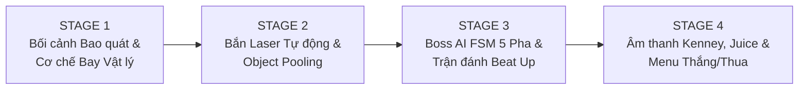
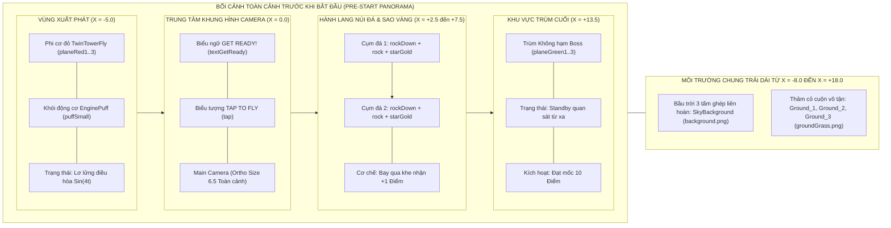

# SKY GUNSHIP CAMPAIGN — LỘ TRÌNH 4 GIAI ĐOẠN (STAGES) PHÁT TRIỂN GAME
> **Mục tiêu:** Xây dựng tựa game hành động 2D **"Sky Gunship Campaign"** (kết hợp cơ chế bay vượt chướng ngại vật *Flappy Bird / Tappy Plane* với đấu trùm bắn súng *Shoot 'em up / Cuphead*) theo lộ trình trực quan nhiều giai đoạn, sử dụng 100% tài nguyên chuẩn từ gói `Assets/Packed/` (Kenney Tappy Plane, Kenney UI Pack Pixel Adventure, Kenney Digital Audio).
> **Điểm nhấn thiết kế:** Màn hình **Scene View & Pre-Start Game View** hiển thị **bao quát toàn bộ bức tranh trò chơi trước khi bắt đầu** (Từ Phi cơ xuất phát $\rightarrow$ Hành lang vách đá & Sao vàng $\rightarrow$ Trùm Không Hạm chờ sẵn cuối đường bay $\rightarrow$ Giao diện "GET READY!").

---

## MỤC LỤC
1. [Tổng Quan Tiến Trình 4 Stage (High-Level Overview)](#1-tổng-quan-tiến-trình-4-stage)
2. [Thiết Kế Màn Hình Scene Hiển Thị Bao Quát Trước Khi Bắt Đầu (Scene Panorama)](#2-thiết-kế-màn-hình-scene-hiển-thị-bao-quát-trước-khi-bắt-đầu)
3. [Stage 1: Khởi Tạo Bối Cảnh Bao Quát & Cơ Chế Bay Vật Lý (Scene Panorama & Core Flight)](#stage-1-khởi-tạo-bối-cảnh-bao-quát--cơ-chế-bay-vật-lý)
4. [Stage 2: Vũ Khí Tự Động, Object Pooling & Vật Phẩm Chiến Trường (Combat & Pooling)](#stage-2-vũ-khí-tự-động-object-pooling--vật-phẩm-chiến-trường)
5. [Stage 3: Trí Tuệ Nhân Tạo Trùm Cuối & Vòng Lặp Đấu Boss (Boss AI FSM & Beat Up)](#stage-3-trí-tuệ-nhân-tạo-trùm-cuối--vòng-lặp-đấu-boss)
6. [Stage 4: Hiệu Ứng Thị Giác, Âm Thanh Kenney & Hoàn Thiện Vòng Lặp (Audio, Juice & UI Loop)](#stage-4-hiệu-ứng-thị-giác-âm-thanh-kenney--hoàn-thiện-vòng-lặp)

---

## 1. TỔNG QUAN TIẾN TRÌNH 4 STAGE

| Giai đoạn | Trọng tâm phát triển | Sản phẩm đầu ra (Deliverables) | Tiêu chí hoàn thành (Acceptance Criteria) |
| :--- | :--- | :--- | :--- |
| **Stage 1** | **Bối cảnh Bao quát & Bay Vật lý** | `FlappyBeatUp_MainScene.unity`, `BirdScript.cs`, `PlaneAnimator.cs`, `ScrollingGround.cs`, `Pipe.prefab` | Mở Scene thấy ngay toàn cảnh: Trời, Đất cỏ, Phi cơ đỏ, 3 cụm Vách đá mẫu, Boss ở rìa phải và bảng `GET READY!`. Chờ người chơi nhấn `Space` mới bắt đầu rơi vật lý. |
| **Stage 2** | **Hệ thống Bắn đạn & Object Pool** | `ObjectPooler.cs`, `BulletScript.cs`, `PlayerBullet.prefab`, `PipeSpawnScript.cs`, `PipeMiddleScript.cs` | Phi cơ tự động bắn tia laser xanh neon từ mũi; đạn lấy từ Pool không gây rác bộ nhớ; qua khe đá cộng điểm chính xác. |
| **Stage 3** | **Trùm Không Hạm & Máy trạng thái FSM** | `BossScript.cs`, `BossBulletScript.cs`, `BossBullet.prefab`, `LogicScript.cs` | Đạt 10 điểm $\rightarrow$ ngừng sinh đá, hú còi báo động `WARNING`, Boss Không Hạm bay vào vị trí chiến đấu, đổi 5 trạng thái (Lượn Sin, Bắn chùm 3 tia, Húc ngang, Cuồng nộ $<40\%$ HP). |
| **Stage 4** | **Âm thanh Kenney, Juice & UI Loop** | `AudioManager.cs`, `CameraShake.cs`, `HUD & GameOver/Victory UI` | Rung màn hình khi nổ/va chạm; Boss chớp trắng khi trúng đạn; 7 âm thanh `.ogg` Kenney; bảng tổng kết Huy chương Vàng/Bạc/Đồng và nút Chơi lại. |

---

## 2. THIẾT KẾ MÀN HÌNH SCENE HIỂN THỊ BAO QUÁT TRƯỚC KHI BẮT ĐẦU

Khác với cách dựng truyền thống (màn hình trống trơn, vào game mới sinh đối tượng bằng code), **`FlappyBeatUp_MainScene.unity`** được bố trí **Trực Quan Toàn Cảnh (Panoramic Stage Overview)** ngay trên **Scene View** và ở trạng thái chờ **`WaitingToStart`** khi mới mở game:

###  Lợi ích của thiết kế Bao Quát Toàn Cảnh (Pre-Start Overview):
1. **Trên cửa sổ `Scene View` (Trước khi bấm Play):** Giảng viên và người phát triển nhìn vào thấy ngay bố cục toàn bộ màn chơi từ trái sang phải: **Phi cơ người chơi** $\rightarrow$ **Hành lang chướng ngại vật vách đá** $\rightarrow$ **Trùm Không Hạm khổng lồ cuối màn**.
2. **Trên cửa sổ `Game View` (Khi vừa bấm Play - Trạng thái `WaitingToStart`):**
   - Máy bay **không bị rơi tự do chết ngay lập tức**, mà lơ lửng nhẹ nhàng tại vị trí xuất phát (`X = -5.0, Y = 0.5`), cánh quạt quay tít.
   - Bảng hiệu **`GET READY!`** và biểu tượng **`TAP`** hiển thị rõ ràng giữa màn hình cùng toàn cảnh bầu trời, thảm cỏ và vách đá phía trước.
   - Ngay khi người chơi nhấn **`Space`** hoặc **`Chuột Trái`** lần đầu tiên $\rightarrow$ Bảng `GET READY!` biến mất, trọng lực kích hoạt và cuộc chiến chính thức bắt đầu!

---

## STAGE 1: KHỞI TẠO BỐI CẢNH BAO QUÁT & CƠ CHẾ BAY VẬT LÝ

### Mục tiêu
Dựng hoàn chỉnh thế giới 2D từ gói **Kenney Tappy Plane**, đảm bảo hiển thị sắc nét, đúng tỉ lệ khung hình `1920x1080` và vận hành mượt mà cơ chế bay trọng lực kèm trạng thái chờ khởi hành.

###  Hạng mục kỹ thuật
- [x] **Tích hợp tài nguyên môi trường (`Assets/Sprites/Environment/`):**
  - Bầu trời `background.png` ($800 \times 480\text{ px}$) ghép nối bao phủ toàn bộ tầm nhìn Camera và khu vực chờ của Boss.
  - Mặt đất `groundGrass.png` ($808 \times 71\text{ px}$) gồm 2 dải `Ground_1` và `Ground_2` nối tiếp nhau, gắn script `ScrollingGround.cs` tự động cuộn khi trận đấu diễn ra.
- [x] **Thực thể Phi cơ Người chơi (`TwinTowerFly` - Layer 3 `Bird`):**
  - Sử dụng bộ 3 ảnh `planeRed1.png`, `planeRed2.png`, `planeRed3.png` gắn script `PlaneAnimator.cs` ($15\text{ fps}$) tạo hiệu ứng cánh quạt quay liên tục.
  - Đuôi máy bay gắn `EnginePuff` (`puffSmall.png`) mô phỏng luồng khói phản lực.
  - Quản lý trạng thái chờ `hasStarted`: Khi chưa nhấn `Space`, máy bay giữ độ cao nhấp nhô nhẹ theo hàm $\sin(t)$; khi nhấn `Space` mới bật `Rigidbody2D` và bắt đầu bay.
  - **Khắc phục lỗi biên (Out-of-Bounds Fix):** Tự động kiểm tra giới hạn trần ($Y > 5.2$) và sàn đất ($Y < -4.1$) để xử lý va chạm tử vong.
- [x] **Chướng ngại vật Vách đá (`Pipe.prefab` & Cụm đá mẫu trên Scene - Layer 6 `Obstacle`):**
  - Nhũ đá trên `TopPipe` (`rockDown.png`) và nhũ đá dưới `BottomPipe` (`rock.png`) kèm `BoxCollider2D`.
  - Khe tính điểm ở giữa `ScoreZone` (`IsTrigger = true`) gắn `PipeMiddleScript.cs` kèm ngôi sao vàng `starGold.png` trực quan.
  - **Khắc phục lỗi cộng điểm sau khi chết:** Chỉ cộng điểm khi `bird.birdIsAlive == true`.

---

## STAGE 2: VŨ KHÍ TỰ ĐỘNG, OBJECT POOLING & VẬT PHẨM CHIẾN TRƯỜNG

### Mục tiêu
Trang bị hỏa lực cho phi cơ người chơi và tối ưu hóa bộ nhớ đệm bằng kỹ thuật **Object Pooling**, giúp xả hàng trăm viên đạn mà không gây giật khung hình (GC Spike).

###  Hạng mục kỹ thuật
- [x] **Bộ quản lý Kho đạn (`ObjectPooler.cs`):**
  - Khởi tạo sẵn hàng đợi `Queue<GameObject>` chứa 25 viên `PlayerBullet` và 30 viên `BossBullet` ngay khi nạp Scene.
  - Cấp phát đạn qua phương thức `SpawnFromPool(tag, position, rotation)` và thu hồi bằng `SetActive(false)` khi đạn bay quá biên màn hình.
- [x] **Cơ chế Khai hỏa Tự động & Thủ công (`BirdScript.cs`):**
  - Điểm bắn `FirePoint` đặt tại mũi phi cơ đỏ.
  - Tự động bắn đạn laser xanh neon (`laserGreen.png`, vận tốc $18\text{ unit/s}$) mỗi $0.28\text{ s}$ khi đã bắt đầu bay, hoặc nhấn phím `F` / Chuột phải.
- [x] **Hệ thống Sinh Chướng ngại vật Động (`PipeSpawnScript.cs`):**
  - Đặt tại rìa phải ($X = 14$), sinh mới các cặp vách đá ngẫu nhiên theo độ cao `heightOffset = 1.6` sau mỗi $2.2\text{ s}$.
  - Tự động tạm dừng khi người chơi chưa nhấn bắt đầu hoặc khi bước vào pha đấu Boss.

---

## STAGE 3: TRÍ TUỆ NHÂN TẠO TRÙM CUỐI & VÒNG LẶP ĐẤU BOSS

### Mục tiêu
Biến màn chơi vượt chướng ngại vật đơn thuần thành trận không chiến kịch tính chống lại **Trùm Không Hạm (Combat Gunship Boss)** được điều khiển bởi Máy trạng thái hữu hạn (FSM).

###  Hạng mục kỹ thuật
- [x] **Thực thể Trùm Không Hạm (`Boss` - Layer 8 `Boss`):**
  - Sử dụng bộ 3 sprite chiến hạm xanh lục `planeGreen1.png`, `planeGreen2.png`, `planeGreen3.png` với kích thước khổng lồ (`Scale = 3.2`).
  - Đặt sẵn tại tọa độ $X = 13.5, Y = 0.8$ để **hiển thị trực quan trong Scene View** (nằm ngay ngoài rìa phải của khung Camera `Game View` $X \in [-8.9, +8.9]$).
- [x] **Kịch bản Chuyển Pha (`LogicScript.cs`):**
  - Khi người chơi đạt mốc **`SCORE >= 10`**:
    1. Ngừng sinh thêm vách đá mới (`pipeSpawner.SetSpawning(false)`).
    2. Bật còi báo động và hiển thị biểu ngữ nhấp nháy **`WARNING: BOSS APPROACHING!`** trong $2.5\text{ s}$.
    3. Kích hoạt Boss bay từ vị trí chờ ($X = 13.5$) tiến vào vị trí tác chiến ($X = 6.0$) và hiển thị Thanh máu Boss trên đỉnh màn hình.
- [x] **Máy Trạng Thái Hữu Hạn 5 Pha của Boss (`BossScript.cs`):**
  - **`Entering`:** Bay tiến vào chốt chặn $X = 6.0$.
  - **`Idle`:** Bay lượn lên xuống theo quỹ đạo hình Sin: $Y = \sin(t \times \omega) \times A$.
  - **`RangedAttack`:** Khai hỏa chùm 3 tia đạn năng lượng đỏ (`laserRed.png`) tỏa góc $[-15^\circ, 0^\circ, +15^\circ]$ nhắm thẳng vào vị trí người chơi.
  - **`DashAttack`:** Gồng cảnh báo đỏ $0.5\text{ s}$, sau đó lao vút sang trái ($X = -4.0$) để ép góc người chơi rồi lùi về chốt.
  - **`Enraged` (Cuồng nộ khi $\text{HP} \le 40\%$):** Thân tàu chuyển màu đỏ rực, tăng $1.5\times$ tốc độ lượn và giảm một nửa thời gian hồi chiêu.

---

## STAGE 4: HIỆU ỨNG THỊ GIÁC, ÂM THANH KENNEY & HOÀN THIỆN VÒNG LẶP

### Mục tiêu
Đánh bóng trải nghiệm nghe nhìn (Game Feel / Juice) và hoàn thiện luồng giao diện từ lúc mở game đến khi Chiến thắng hoặc Chơi lại.

###  Hạng mục kỹ thuật
- [x] **Hệ thống Âm thanh 8-Bit / Arcade (`AudioManager.cs`):**
  - Tích hợp trọn bộ âm thanh `.ogg` từ gói **Kenney Digital Audio**:
    - `flap.ogg`: Tiếng vọt cánh khi nhấn Space.
    - `shoot.ogg`: Tiếng bắn tia laser.
    - `score.ogg`: Tiếng chuông ăn điểm & sao vàng.
    - `warning.ogg`: Tiếng còi báo động Boss xuất hiện.
    - `hit.ogg`: Tiếng đạn găm vào giáp Boss.
    - `explosion.ogg`: Tiếng nổ lớn khi va chạm hoặc hạ Boss.
    - `victory.ogg`: Giai điệu chiến thắng.
- [x] **Hiệu ứng Phản hồi Thị giác (Visual Juice):**
  - **Rung chấn Camera (`CameraShake.cs`):** Giật khung hình khi máy bay đâm vào đá, khi Boss lao húc hoặc khi Boss nổ tung.
  - **Chớp trắng trúng đạn (`Damage Flash`):** Boss nháy sáng trắng trong $0.05\text{ s}$ mỗi khi trúng đạn laser của người chơi.
- [x] **Vòng lặp Giao diện Toàn diện (Full UI Loop):**
  - **Màn hình Chờ (`Pre-Start`):** Banner `GET READY!`, biểu tượng `TAP`, hướng dẫn phím trực quan.
  - **Màn hình Chiến đấu (`In-Game HUD`):** Điểm số, cảnh báo Boss, Thanh máu Boss động.
  - **Màn hình Kết thúc (`Victory / Game Over`):** Hiển thị tổng điểm, trao Huy chương (`medalGold.png`), nút `PLAY AGAIN` (hoặc nhấn nhanh `Space` / `R`).

