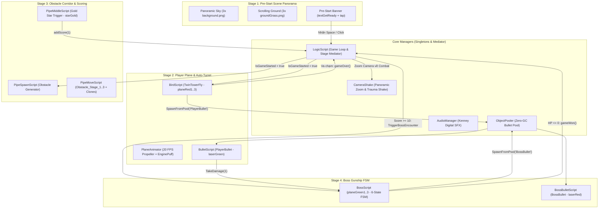
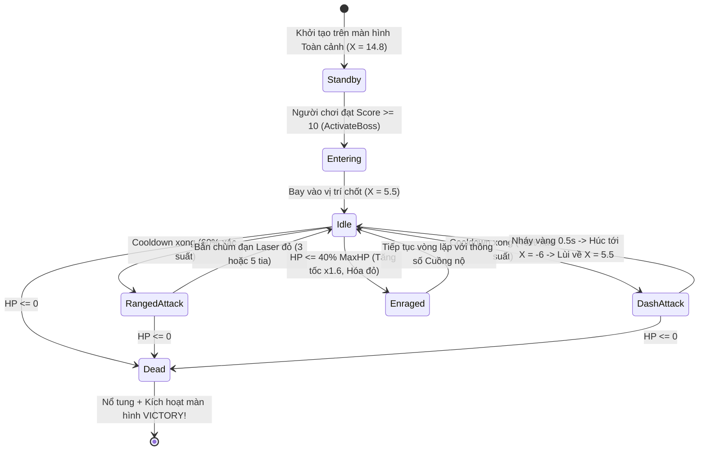

# TÀI LIỆU THIẾT KẾ HỆ THỐNG: SKY GUNSHIP CAMPAIGN (UNITY 6 EDITION)

Tài liệu này mô tả chi tiết kiến trúc kỹ thuật, bố cục **Pre-Start Panoramic Scene Overview (Màn hình bao quát trò chơi trước khi bắt đầu)**, cấu trúc Scene/Prefab, ma trận va chạm vật lý 2D, các thuật toán cốt lõi (Vật lý bay Flappy, Object Pooling, Máy trạng thái hữu hạn Boss FSM) và thiết kế lớp C# cho dự án **Sky Gunship Campaign** trên **Unity 6 (`6000.6.7f1`)** sử dụng bộ tài nguyên chuẩn **Kenney CC0 (`Assets/Packed/`)**.

---

## 1. Kiến trúc Tổng thể (System Architecture)

Dự án áp dụng mô hình **Component-Based Architecture** kết hợp **Mediator Pattern** (`LogicScript`), **Singleton Pattern** (`ObjectPooler`, `AudioManager`, `CameraShake`) và **Finite State Machine (FSM)** (`BossScript`). Toàn bộ luồng trò chơi được chia thành 4 giai đoạn trực quan (Stage 1 $\rightarrow$ Stage 4):



---

## 2. Cấu trúc Thư mục Dự án (Folder Structure)

Toàn bộ tài nguyên được trích xuất chuẩn hóa từ `Assets/Packed/` (`kenney_tappy-plane`, `kenney_ui-pack-pixel-adventure`, `kenney_digital-audio`):

```text
d:\Do an 2026\MTA\Unity\Project\
├── Assets/
│   ├── Packed/                        # Bộ Asset gốc Kenney CC0
│   │   ├── kenney_tappy-plane/        # Máy bay, Núi đá, Sao vàng, Bầu trời, Mặt đất
│   │   ├── kenney_ui-pack-pixel-adventure/ # Khung UI Pixel
│   │   └── kenney_digital-audio/      # Hiệu ứng âm thanh laser, cảnh báo, nổ
│   ├── Scenes/
│   │   └── FlappyBeatUp_MainScene.unity # Scene chính hiển thị bao quát toàn bộ trò chơi
│   ├── Prefabs/
│   │   ├── Pipe.prefab                # Cặp chướng ngại vật đá + Ngôi sao vàng ở khe giữa
│   │   ├── PlayerBullet.prefab        # Đạn Laser xanh của người chơi (Object Pool)
│   │   └── BossBullet.prefab          # Đạn Laser đỏ của Boss (Object Pool)
│   ├── Scripts/
│   │   ├── LogicScript.cs             # Điều phối 4 Stage, Điểm số, HUD OnGUI & Chuyển màn
│   │   ├── BirdScript.cs              # Điều khiển máy bay đỏ, lơ lửng chờ lệnh, bắn đạn
│   │   ├── PlaneAnimator.cs           # Hoạt ảnh cánh quạt quay 3 frame liên tục
│   │   ├── ScrollingGround.cs         # Cuộn mặt đất vô tận đồng bộ trạng thái game
│   │   ├── PipeSpawnScript.cs         # Sinh chướng ngại vật theo nhịp
│   │   ├── PipeMoveScript.cs          # Di chuyển chướng ngại vật & tự hủy ở DeadZone
│   │   ├── PipeMiddleScript.cs        # Trigger ăn Ngôi sao vàng (+1 Score)
│   │   ├── ObjectPooler.cs            # Hồ chứa đạn tái sử dụng (Queue<GameObject>)
│   │   ├── BulletScript.cs            # Logic bay & gây sát thương của đạn người chơi
│   │   ├── BossScript.cs              # Máy trạng thái hữu hạn 6 pha của Boss Gunship
│   │   ├── BossBulletScript.cs        # Đạn Boss bay theo vector hướng mục tiêu
│   │   ├── CameraShake.cs             # Chuyển góc nhìn Toàn cảnh -> Chiến đấu & Rung lắc
│   │   ├── AudioManager.cs            # Quản lý âm thanh SFX / BGM
│   │   └── Editor/
│   │       └── PanoramicSceneBuilder.cs # Công cụ tự động dựng Scene Toàn cảnh & Prefabs
│   ├── Sprites/
│   │   ├── Player/                    # planeRed1.png, planeRed2.png, planeRed3.png
│   │   ├── Boss/                      # planeGreen1.png, planeGreen2.png, planeGreen3.png
│   │   ├── Environment/               # background.png, groundGrass.png, rock.png, rockDown.png, starGold.png, puffSmall.png
│   │   ├── Weapons/                   # laserGreen.png, laserRed.png
│   │   └── UI/                        # textGetReady.png, textGameOver.png, tap.png, medalGold.png
│   └── Audio/
│       └── SFX/                       # flap.ogg, shoot.ogg, boss_shoot.ogg, score.ogg, warning.ogg, hit.ogg, explosion.ogg, victory.ogg
└── docs/
    ├── GAME_DEVELOPMENT_ROADMAP.md          # Lộ trình phát triển trực quan 4 Stage
    ├── FLAPPY_BEAT_UP_SYSTEM_DESIGN_UNITY.md # Tài liệu thiết kế hệ thống chi tiết (File này)
    ├── BAO_CAO_DO_AN_FLAPPY_BEAT_UP.md      # Báo cáo đồ án môn học hoàn chỉnh
    └── HUONG_DAN_KIEM_THU_VA_MO_RONG_DO_AN.md # Hướng dẫn kiểm thử và mở rộng
```

---

## 3. Thiết kế Màn hình Toàn cảnh Trước khi Bắt đầu (Pre-Start Panoramic Scene Overview)

### 3.1. Sơ đồ Bố cục Không gian 2D (World Space Panorama)
Để đáp ứng yêu cầu **hiển thị bao quát toàn bộ trò chơi trước khi bắt đầu** ngay trên cả cửa sổ `#Scene` lẫn `#Game`, toàn bộ các thành phần cốt lõi của 4 Stage đều được đặt sẵn trên sân khấu theo trục ngang từ `X = -8.0` đến `X = +16.0`:

```text
+---------------------------------------------------------------------------------------------------+
| [STAGE 1: SKY & GROUND]  Bầu trời 3 tấm liên hoàn (X = -8 -> +18) + Thảm cỏ cuộn dưới đáy         |
|                                                                                                   |
|  [STAGE 2: PLAYER]         [STAGE 3: OBSTACLE CORRIDOR & STARS]          [STAGE 4: BOSS GUNSHIP]  |
|                                  ||                  ||                  ||                       |
|                            [Top RockDown]      [Top RockDown]      [Top RockDown]                 |
|                                  ||                  ||                  ||                       |
|   (EnginePuff)                   ..                  ..                  ..      ================ |
|     o o [PlaneRed] ===>         (*)                 (*)                 (*)     <| BOSS GUNSHIP | |
|    (X=-5.2, Y=0.5)            (X=1.0)             (X=5.5)            (X=10.0)    ================ |
|                                  ..                  ..                  ..      (X=14.8, Y=0.8)  |
|                                  ||                  ||                  ||       [State: Standby]|
|                            [Bot RockUp]        [Bot RockUp]        [Bot RockUp]                   |
|                                                                                                   |
|                         [ UI BANNER: "GET READY!" + "TAP TO FLY & SHOOT" ]                        |
|===================================================================================================|
| ////////////////////// THẢM CỎ MẶT ĐẤT (groundGrass.png x3 tấm liền mạch) /////////////////////// |
+---------------------------------------------------------------------------------------------------+
```

### 3.2. Cấu trúc Cây phân cấp Scene (Scene Hierarchy)
1. **`Main Camera`** (`Camera`, `CameraShake`):
   - Ở trạng thái **Pre-Start (`IsGameStarted == false`)**: Đặt tại `(3.8, 0.2, -10)` với `orthographicSize = 6.5` để khung hình `#Game` bao quát trọn vẹn từ Máy bay Đỏ bên trái, 3 cổng Đá + Sao vàng ở giữa cho tới Chiến hạm Boss Xanh bên phải.
   - Khi nhấn **`Space` / Chuột trái (`IsGameStarted == true`)**: `CameraShake` tự động nội suy mượt (`Mathf.Lerp`) về tâm chiến đấu `(0, 0, -10)` với `orthographicSize = 5.0`.
2. **`SkyBackground_Left` / `SkyBackground_Center` / `SkyBackground_Right`** (`SpriteRenderer` - `SortingOrder = -10`):
   - Ghép 3 tấm `background.png` liền kề tại `X = -8.0, 4.0, 16.0`, phủ kín toàn bộ tầm nhìn toàn cảnh.
3. **`Ground_1` / `Ground_2` / `Ground_3`** (`SpriteRenderer`, `BoxCollider2D`, `ScrollingGround` - `SortingOrder = 5`):
   - Đặt tại `Y = -4.6`, đứng yên khi xem toàn cảnh và bắt đầu cuộn sang trái với vận tốc `6.5 m/s` khi bắt đầu bay.
4. **`TwinTowerFly` (Player Plane)** (`Rigidbody2D`, `CircleCollider2D`, `BirdScript`, `PlaneAnimator` - `SortingOrder = 10`):
   - Đặt tại `(-5.2, 0.5, 0)`. Gồm các node con: `FirePoint` `(0.9, -0.1, 0)` và `EnginePuff` (`puffSmall.png` tại `(-0.9, 0, 0)`).
5. **`Obstacle_Stage_1` / `Obstacle_Stage_2` / `Obstacle_Stage_3`** (`PipeMoveScript` - `SortingOrder = 2`):
   - 3 cụm chướng ngại vật đặt sẵn tại `X = 1.0`, `X = 5.5`, `X = 10.0` (độ cao lệch nhau trực quan). Mỗi cụm gồm `TopPipe` (`rockDown.png`), `BottomPipe` (`rock.png`) và `MiddleTrigger` (`PipeMiddleScript` kèm biểu tượng ngôi sao `starGold.png` ở chính giữa khe hẹp).
6. **`Pipe Spawner`** (`PipeSpawnScript`):
   - Đặt tại `(14.5, 0, 0)`, tự động sinh tiếp các cặp `Pipe.prefab` sau khi người chơi bắt đầu bay.
7. **`Boss` (Combat Gunship)** (`BossScript`, `PlaneAnimator`, `BoxCollider2D (Trigger)` - `SortingOrder = 9`):
   - Đặt tại `(14.8, 0.8, 0)` với kích thước khổng lồ `Scale = (-2.8, 2.8, 1)` (quay mặt sang trái đối diện người chơi).
   - Ở trạng thái Pre-Start, Boss hoạt động ở pha `BossState.Standby` (lơ lửng tại chỗ để người chơi quan sát trong màn hình bao quát). Khi trận đấu bắt đầu, Boss lùi ra ngoài biên chờ đến khi `Score >= 10` sẽ kích hoạt `ActivateBoss()` và lao vào vị trí chiến đấu `anchorX = 5.5`.
8. **`UI_GetReadyBanner` & `UI_TapIcon`** (`SpriteRenderer` - `SortingOrder = 20`):
   - Hiển thị trực quan biểu ngữ `textGetReady.png` và biểu tượng `tap.png` ngay trên Scene & Game trước khi xuất phát.
9. **`Logic Manager` / `Object Pooler` / `Audio Manager`**:
   - Các đối tượng điều phối trung tâm của trò chơi.

---

## 4. Ma trận Va chạm Vật lý 2D (Physics 2D Layer Matrix)

Hệ thống phân tách rõ các lớp vật lý (`Layer`) để đạn người chơi không bắn trúng chính mình hoặc chướng ngại vật, và đạn Boss chỉ gây sát thương lên người chơi:

| Layer Index | Tên Layer | Đối tượng | Tương tác Va chạm (Collider / Trigger) |
| :--- | :--- | :--- | :--- |
| **Layer 0** | `Default` | Mặt đất (`Ground`), Đá (`TopPipe`, `BottomPipe`) | Va chạm vật lý cứng (`OnCollisionEnter2D`) với `Player` |
| **Layer 3** | `Ignore Raycast` | Khe tính điểm (`MiddleTrigger` + `starGold`) | `IsTrigger = true`, phát hiện `Player` bay qua để cộng điểm |
| **Layer 6** | `Player` | Máy bay `TwinTowerFly` (`Tag: Player`) | Va chạm với Đá/Mặt đất, nhận Trigger từ `Boss` & `BossBullet` |
| **Layer 7** | `PlayerBullet` | Đạn `PlayerBullet` (`laserGreen.png`) | `IsTrigger = true`, chỉ gây sát thương khi chạm `Boss` (Layer 8) |
| **Layer 8** | `Boss` | Chiến hạm `Boss` (`Tag: Boss`) | `IsTrigger = true`, nhận sát thương từ `PlayerBullet`, tiêu diệt `Player` nếu đâm trực diện |
| **Layer 9** | `BossBullet` | Đạn `BossBullet` (`laserRed.png`) | `IsTrigger = true`, tiêu diệt `Player` (Layer 6) khi trúng đạn |

---

## 5. Các Thuật toán Cốt lõi (Core Algorithms)

### 5.1. Thuật toán Trạng thái Lơ lửng Trước khi Xuất phát (`WaitingToStart` Hover)
Trước khi người chơi nhấn `Space` hoặc `Chuột trái` (`logic.IsGameStarted == false`), `Rigidbody2D` của máy bay được khóa mô phỏng trọng lực (`myRigidbody.simulated = false`) và máy bay dao động điều hòa nhẹ nhàng quanh tọa độ gốc $Y_0$:

$$Y(t) = Y_0 + A_{hover} \cdot \sin(\omega_{hover} \cdot t)$$

với $A_{hover} = 0.22\text{ m}$ và $\omega_{hover} = 4.0\text{ rad/s}$. Ngay khi phát hiện xung nhịp đầu vào (`Space` / `Mouse0`), hệ thống gọi `logic.StartGame()`, bật `myRigidbody.simulated = true` và truyền vận tốc nhảy tức thời $v_y = v_{flap}$.

### 5.2. Vật lý Bay Flappy & Nội suy Góc chúc mũi (Pitch Tilt)
Khi đang bay (`IsGameStarted == true`), vận tốc rơi tự do chịu gia tốc trọng trường $g$. Góc nghiêng thân máy bay $\theta$ (Pitch) được ánh xạ tuyến tính từ vận tốc dọc $v_y$ và kẹp trong miền an toàn $[-45^\circ, +25^\circ]$:

$$\theta = \text{Clamp}(v_y \cdot k_{tilt}, -45^\circ, +25^\circ)$$

### 5.3. Thuật toán Quỹ đạo Lượn sóng & Đạn tỏa hình quạt của Boss (Spread Shot)
- **Quỹ đạo tuần tra (`BossState.Idle`):** Boss giữ nguyên hoành độ chốt $X_{anchor} = 5.5$ và lượn lên xuống theo hàm điều hòa:

$$Y_{boss}(t) = A_{sin} \cdot \sin(f_{sin} \cdot t)$$

- **Đạn chùm hướng mục tiêu (`BossState.RangedAttack`):** Gọi $\vec{d}_{base}$ là vector đơn vị hướng từ nòng súng Boss $\vec{P}_{boss}$ tới vị trí hiện tại của người chơi $\vec{P}_{player}$:

$$\vec{d}_{base} = \frac{\vec{P}_{player} - \vec{P}_{boss}}{\|\vec{P}_{player} - \vec{P}_{boss}\|}$$

Với mỗi góc lệch $\alpha_i \in \{-20^\circ, 0^\circ, +20^\circ\}$ (hoặc $5$ tia $\{-30^\circ, -15^\circ, 0^\circ, +15^\circ, +30^\circ\}$ khi **Enraged**), vector bay của viên đạn thứ $i$ được tính bằng phép quay 2D:

$$\vec{d}_i = R_z(\alpha_i) \cdot \vec{d}_{base}$$

---

## 6. Sơ đồ Máy trạng thái Hữu hạn Boss (Boss FSM Diagram)



---

## 7. Đặc tả Chi tiết các Lớp C# (Class Specifications)

| Tên Script | Vai trò chính | Thuộc tính cấu hình quan trọng |
| :--- | :--- | :--- |
| [`LogicScript.cs`](file:///d:/Do%20an%202026/MTA/Unity/Project/Assets/Scripts/LogicScript.cs) | Điều phối trạng thái `IsGameStarted`, điểm số, cảnh báo Boss và giao diện HUD `OnGUI` | `scoreToSpawnBoss = 10`, `IsGameStarted`, `IsGameEnded` |
| [`BirdScript.cs`](file:///d:/Do%20an%202026/MTA/Unity/Project/Assets/Scripts/BirdScript.cs) | Điều khiển máy bay đỏ, lơ lửng ở Pre-Start, nhảy khi nhấn `Space`, tự động bắn đạn | `flapStrength = 8.5f`, `fireRate = 0.30f`, `topBound = 5.8f`, `bottomBound = -4.5f` |
| [`PlaneAnimator.cs`](file:///d:/Do%20an%202026/MTA/Unity/Project/Assets/Scripts/PlaneAnimator.cs) | Tạo hoạt ảnh quay cánh quạt mượt mà từ mảng 3 Sprite của Kenney | `frames[]` (`planeRed1..3` / `planeGreen1..3`), `fps = 20f` |
| [`ScrollingGround.cs`](file:///d:/Do%20an%202026/MTA/Unity/Project/Assets/Scripts/ScrollingGround.cs) | Cuộn mặt đất vô tận khi `IsGameStarted == true` | `scrollSpeed = 6.5f`, `thresholdX`, `resetOffset` |
| [`PipeSpawnScript.cs`](file:///d:/Do%20an%202026/MTA/Unity/Project/Assets/Scripts/PipeSpawnScript.cs) | Sinh chướng ngại vật đá + sao vàng theo chu kỳ và ngắt khi Boss xuất hiện | `spawnRate = 2.2f`, `heightOffset = 1.6f`, `isSpawning` |
| [`PipeMoveScript.cs`](file:///d:/Do%20an%202026/MTA/Unity/Project/Assets/Scripts/PipeMoveScript.cs) | Di chuyển các trụ đá sang trái khi trận đấu đã bắt đầu | `moveSpeed = 5.5f`, `deadZone = -16.0f` |
| [`PipeMiddleScript.cs`](file:///d:/Do%20an%202026/MTA/Unity/Project/Assets/Scripts/PipeMiddleScript.cs) | Phát hiện máy bay bay qua khe đá, ẩn ngôi sao vàng và cộng `+1` điểm | `scoreValue = 1` |
| [`ObjectPooler.cs`](file:///d:/Do%20an%202026/MTA/Unity/Project/Assets/Scripts/ObjectPooler.cs) | Quản lý hồ chứa đạn `PlayerBullet` (30 viên) và `BossBullet` (50 viên) | `pools` (`tag`, `prefab`, `size`) |
| [`BossScript.cs`](file:///d:/Do%20an%202026/MTA/Unity/Project/Assets/Scripts/BossScript.cs) | Điều khiển Boss Gunship qua 6 trạng thái (`Standby` $\rightarrow$ `Dead`) | `maxHP = 50`, `anchorX = 5.5f`, `sinAmplitude = 2.4f`, `dashTargetX = -4.5f` |
| [`CameraShake.cs`](file:///d:/Do%20an%202026/MTA/Unity/Project/Assets/Scripts/CameraShake.cs) | Chuyển mượt góc nhìn từ Toàn cảnh (Panoramic) sang Chiến đấu + Rung chấn | `panoramicPos`, `panoramicSize = 6.5f`, `combatPos`, `combatSize = 5.0f` |

